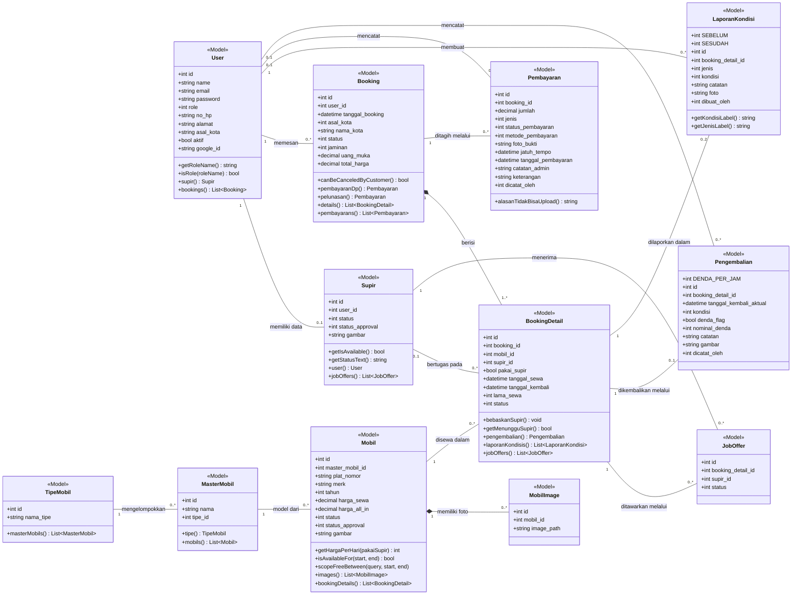
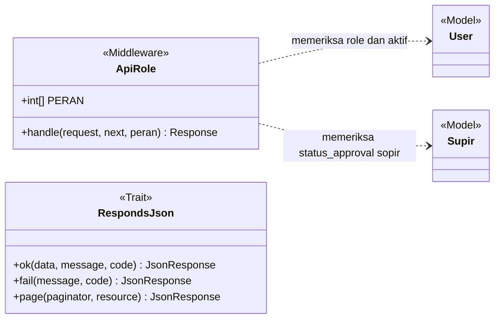
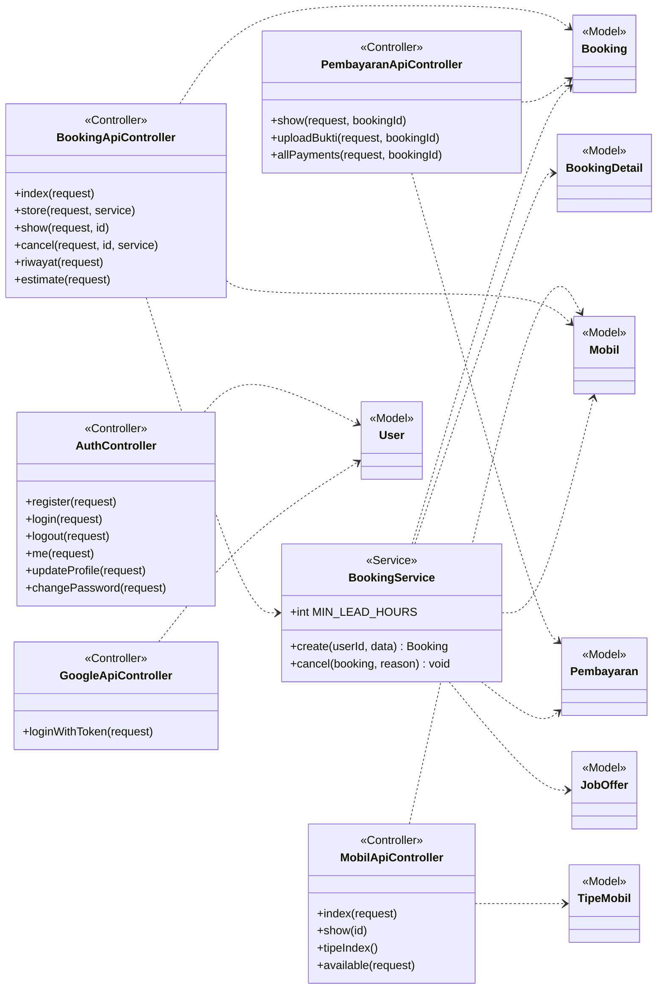
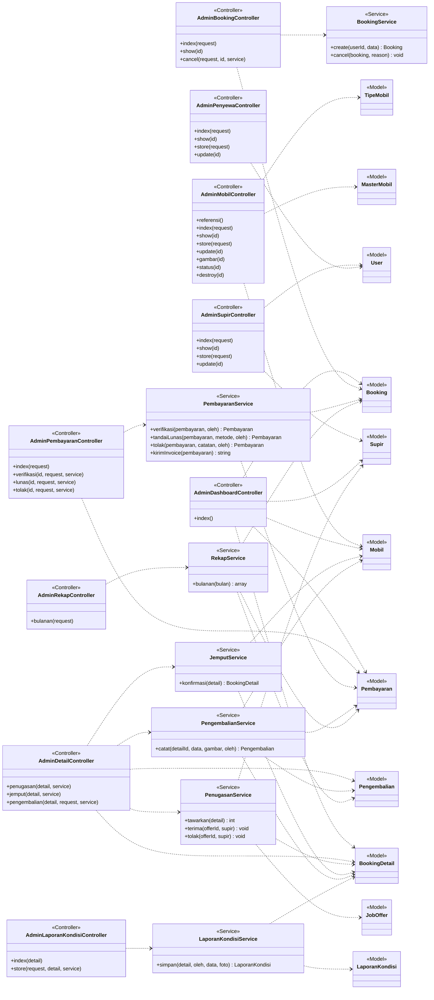
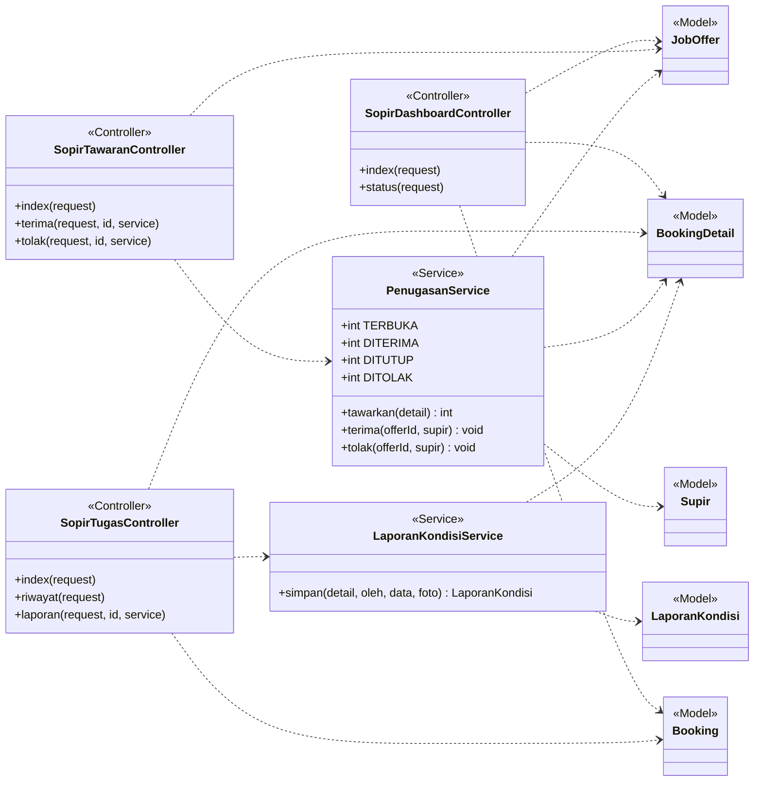
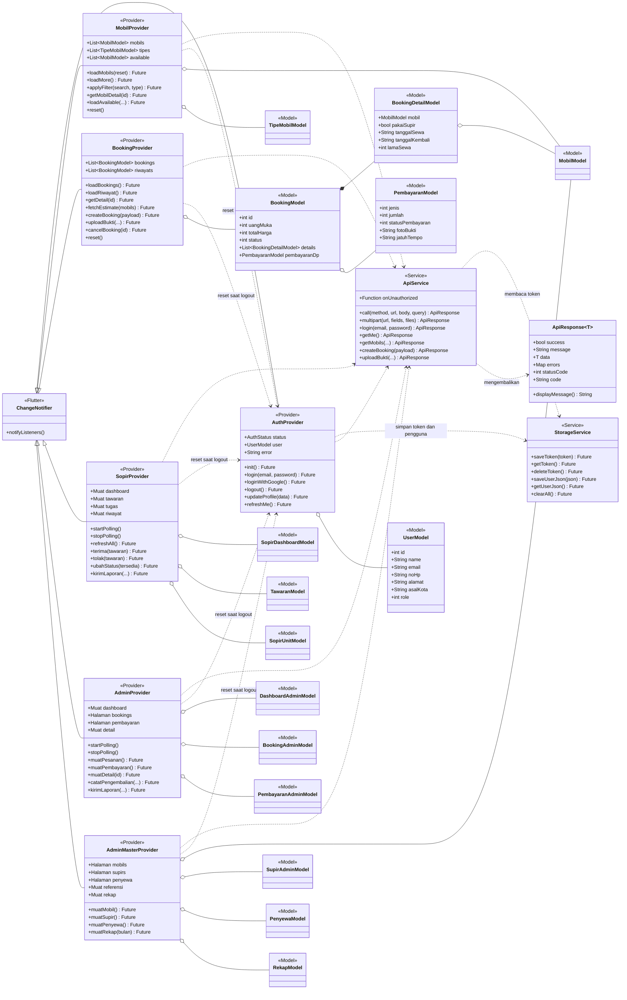

# Class Diagram
# Sistem Informasi Manajemen Rental Mobil Harkat Yogyakarta (Aplikasi Mobile Flutter + RESTful API Laravel)

> **Versi:** 1.0 | **Tanggal:** 7 Oktober 2026
> **Penulis:** Betrand Alfayedh
> **Sumber:** kode program yang telah dibangun dan diuji (`app/Models`, `app/Services`, `app/Http/Controllers/Api`, `mobile_app/lib`). Nama kelas, atribut, dan metode diambil dari kode, bukan dirancang ulang.
> **Dokumen pasangan:** [erd.md](erd.md) (struktur tabel), [usecase.md](usecase.md)

---

## 1. Pendahuluan

Sistem terdiri dari dua bagian yang dijelaskan dengan class diagram terpisah:

| Bagian | Teknologi | Diagram |
|--------|-----------|---------|
| **RESTful API** | Laravel 12, Sanctum, MySQL | 1) kelas entitas, 2) lapisan API untuk pelanggan, admin, dan sopir |
| **Aplikasi mobile** | Flutter (Provider) | 3) kelas aplikasi mobile |

Lapisan pada RESTful API mengikuti pola berikut: **Controller** menerima permintaan dan membentuk respons, **Service** menjalankan aturan bisnis di dalam transaksi basis data, dan **Model** mewakili tabel. Controller yang hanya membaca atau mengubah satu tabel secara sederhana langsung memakai Model tanpa Service.

### 1.1 Notasi

| Notasi | Arti |
|--------|------|
| Kotak tiga bagian | Nama kelas, atribut, metode |
| `+` | Anggota publik |
| `<<Controller>>`, `<<Service>>`, `<<Model>>` | Stereotipe peran kelas |
| `A "1" -- "0..*" B` | Asosiasi dengan kardinalitas (1 A memiliki nol atau banyak B) |
| `A "1" *-- "1..*" B` | Komposisi: B tidak ada tanpa A |
| `A ..> B` | A bergantung pada (memakai) B |
| `A <\|-- B` | B mewarisi A |
| `A o-- B` | Agregasi: A menyimpan B |

Atribut entitas mengikuti kolom tabel pada [erd.md](erd.md). Pada diagram hanya atribut inti dan metode perilaku yang ditampilkan; kamus data lengkap ada di ERD.

---

## 2. Class Diagram Entitas (Model)

Kelas entitas adalah model Eloquent yang memetakan tabel. Enumerasi status disimpan sebagai bilangan bulat; artinya dijelaskan di tabel 2.1.

### 2.1 Arti Nilai Status

| Kelas | Atribut | Nilai |
|-------|---------|-------|
| User | `role` | 1 Super Admin (di luar lingkup), 2 Admin, 3 Sopir, 4 Pelanggan |
| Supir | `status` | 0 libur, 1 tersedia, 2 bertugas |
| Supir, Mobil | `status_approval` | 0 ditolak, 1 disetujui, 2 menunggu |
| Mobil | `status` | 0 rusak, 1 tersedia, 2 dibooking, 3 disewa, 4 maintenance |
| Booking, BookingDetail | `status` | 0 batal, 1 booked, 2 ongoing, 3 done |
| Booking | `jaminan` | 1 KTP atau paspor, 2 KTP dan motor |
| Booking | `asal_kota` | 1 Yogyakarta, selain itu luar kota (nama pada `nama_kota`) |
| Pembayaran | `jenis` | 1 uang muka (DP), 2 pelunasan (termasuk denda) |
| Pembayaran | `status_pembayaran` | 0 belum bayar, 2 menunggu verifikasi, 1 lunas |
| Pembayaran | `metode_pembayaran` | 1 tunai, 2 transfer, 3 QRIS |
| Pengembalian | `kondisi` | 1 baik, 0 rusak |
| JobOffer | `status` | 0 terbuka, 1 diterima, 2 ditutup, 3 ditolak |
| LaporanKondisi | `jenis` | 1 sebelum sewa, 2 sesudah sewa |
| LaporanKondisi | `kondisi` | 1 baik, 2 lecet atau perlu perhatian, 3 rusak |

### 2.2 Keterangan Kelas

| Kelas | Tabel | Tanggung jawab |
|-------|-------|----------------|
| User | `users` | Akun semua peran; `aktif = 0` menolak login |
| Supir | `supirs` | Data sopir dan ketersediaannya; identitas (nama, surel, nomor HP) ada pada User |
| TipeMobil, MasterMobil | `tipe_mobils`, `master_mobils` | Pengelompokan armada menjadi tipe dan model |
| Mobil | `mobils` | Unit armada; `isAvailableFor` memeriksa bentrok jadwal berdasarkan tumpang tindih tanggal |
| MobilImage | `mobil_images` | Foto tambahan unit |
| Booking | `bookings` | Satu pesanan pelanggan; menyimpan jaminan, uang muka, dan total |
| BookingDetail | `booking_details` | Satu unit mobil dalam pesanan beserta jadwal dan sopir yang bertugas |
| Pembayaran | `pembayarans` | Tagihan uang muka, pelunasan, dan denda beserta bukti bayarnya |
| Pengembalian | `pengembalians` | Catatan kembalinya unit; `DENDA_PER_JAM` = Rp50.000 |
| JobOffer | `job_offers` | Tawaran tugas kepada sopir untuk satu unit sewa |
| LaporanKondisi | `laporan_kondisis` | Laporan kondisi kendaraan sebelum dan sesudah sewa |

---

## 3. Class Diagram Lapisan API

Setiap permintaan melewati dua pemeriksaan sebelum masuk ke Controller: token Sanctum (`auth:sanctum`) dan middleware **ApiRole** yang memeriksa peran, status `aktif`, serta, untuk sopir, persetujuan akun. Peran dibaca dari basis data, bukan dari token, sehingga perubahan peran atau penonaktifan akun langsung berlaku. Seluruh Controller memakai trait **RespondsJson** untuk membentuk respons seragam (`status`, `message`, `data`, `meta`).

### 3.1 API untuk Pelanggan

Seluruh rute pelanggan berada di bawah `api.role:customer`. Registrasi, login, dan login Google tidak memerlukan token.

### 3.2 API untuk Admin

Seluruh rute admin berada di bawah `api.role:admin`.

Pada kode, Controller admin berada pada namespace `App\Http\Controllers\Api\Admin` dengan nama `BookingApiController`, `PembayaranApiController`, dan seterusnya; diberi awalan *Admin* pada diagram agar tidak sama dengan Controller pelanggan yang bernama serupa.

### 3.3 API untuk Sopir

Seluruh rute sopir berada di bawah `api.role:sopir`.

Pada kode, nama Controller sopir adalah `DashboardApiController`, `TawaranApiController`, dan `TugasApiController` pada namespace `App\Http\Controllers\Api\Sopir`.

### 3.4 Tanggung Jawab Service

| Service | Aturan bisnis yang dijalankan |
|---------|-------------------------------|
| BookingService | Pesanan paling cepat 3 jam lagi; mobil dikunci dan diperiksa bentrok jadwal; biaya dibulatkan ke atas per 24 jam; uang muka 50% dengan batas bayar paling lambat 4 hari atau 2 jam sebelum sewa; pembatalan membebaskan unit dan menutup tawaran |
| PembayaranService | Verifikasi bukti, pencatatan tunai, penolakan bukti dengan alasan, dan pengiriman invoice lewat surel; invoice dikirim setelah respons terkirim sehingga kegagalan surel tidak menggagalkan verifikasi |
| PenugasanService | Menawarkan unit bersopir kepada seluruh sopir yang tersedia; penerimaan diproses bergantian (kunci baris) sehingga hanya satu sopir yang mendapat tugas; tawaran lain ditutup |
| JemputService | Menandai unit sudah dijemput (ongoing) hanya bila uang muka lunas dan unit tersedia |
| PengembalianService | Mencatat kembalinya unit, menghitung denda Rp50.000 per jam yang sudah dimulai, menambahkannya ke tagihan, mengubah status mobil dan sopir, dan menutup pesanan bila semua unit kembali |
| LaporanKondisiService | Menyimpan laporan kondisi sebelum atau sesudah sewa (satu per jenis) beserta foto |
| RekapService | Menghitung rekap bulanan: jumlah pesanan per status, pendapatan, denda, dan utilisasi armada |

---

## 4. Class Diagram Aplikasi Mobile (Flutter)

Aplikasi memakai pola **Provider**: layar (*screen*) mengamati *provider*, *provider* memanggil **ApiService**, dan hasilnya disimpan sebagai model. Provider selain `AuthProvider` dibuat dengan `ChangeNotifierProxyProvider` yang bergantung pada `AuthProvider`, sehingga seluruh data pengguna sebelumnya dikosongkan saat logout.

### 4.1 Kelas Pendukung

| Kelas | Fungsi |
|-------|--------|
| `Muat<T>` | Membungkus satu data dengan keadaan `loading`, `loaded`, dan `error` agar layar dapat menampilkan indikator, pesan galat, atau isi |
| `Halaman<T>` | Daftar berhalaman dari API (item, halaman sekarang, halaman terakhir, status muat pertama dan lanjutan) |
| `Hasil` | Hasil sebuah aksi: `galat` bila gagal dan `info` untuk pesan tambahan (mis. invoice gagal dikirim) |
| `LaporanKondisiModel`, `UnitAdminModel`, `PengembalianAdminModel`, `DendaKeterlambatan` | Model rincian unit sewa, pengembalian, dan pratinjau denda |

### 4.2 Layar menurut Peran

Setelah login, `shellFor(user)` memilih kerangka layar sesuai peran.

| Peran | Kerangka | Layar |
|-------|----------|-------|
| Pelanggan | `HomeScreen` (setelah `SplashScreen` dan `LoginScreen`) | `MobilListScreen`, `MobilDetailScreen`, `BookingFormScreen`, `BookingListScreen`, `PaymentScreen`, `RiwayatScreen`, `ProfileScreen` |
| Admin | `AdminShell` | `AdminHomeScreen`, `PesananListScreen`, `PesananDetailScreen`, `PembayaranListScreen`, `PengembalianFormScreen`, `ArmadaListScreen`, `ArmadaFormScreen`, `SopirAdminListScreen`, `SopirFormScreen`, `PenyewaListScreen`, `PenyewaFormScreen`, `RekapScreen`, `LainnyaScreen` (menu data master) |
| Sopir | `SopirShell` | `SopirHomeScreen`, `TawaranScreen`, `TugasScreen`, `RiwayatSopirScreen`, `LaporanKondisiScreen` |

---

## 5. Keterlusuran ke Use Case

| Use case | Kelas utama (API) | Kelas utama (mobile) |
|----------|-------------------|----------------------|
| UC1 sampai UC4 Akun | AuthController, GoogleApiController, ApiRole | AuthProvider, StorageService |
| UC5 sampai UC6 Katalog dan estimasi | MobilApiController, BookingApiController (estimate) | MobilProvider, BookingProvider |
| UC7 Memesan Mobil | BookingApiController, BookingService | BookingProvider |
| UC8 Mengunggah Bukti | PembayaranApiController | BookingProvider |
| UC9 sampai UC10 Pesanan dan pembatalan | BookingApiController, BookingService | BookingProvider |
| UC11 sampai UC12 Dashboard dan pantauan | Admin DashboardApiController, Admin BookingApiController | AdminProvider |
| UC13 sampai UC15 Pembayaran | Admin PembayaranApiController, PembayaranService | AdminProvider |
| UC16 Menugaskan Sopir | Admin DetailApiController, PenugasanService | AdminProvider |
| UC17 Jemput | Admin DetailApiController, JemputService | AdminProvider |
| UC18 Pengembalian dan denda | Admin DetailApiController, PengembalianService | AdminProvider |
| UC19 Laporan kondisi | Admin LaporanKondisiApiController, Sopir TugasApiController, LaporanKondisiService | AdminProvider, SopirProvider |
| UC20 sampai UC22 Data master | Admin MobilApiController, SupirApiController, PenyewaApiController | AdminMasterProvider |
| UC23 Rekap bulanan | Admin RekapApiController, RekapService | AdminMasterProvider |
| UC24 sampai UC28 Tugas sopir | Sopir DashboardApiController, TawaranApiController, TugasApiController, PenugasanService | SopirProvider |
