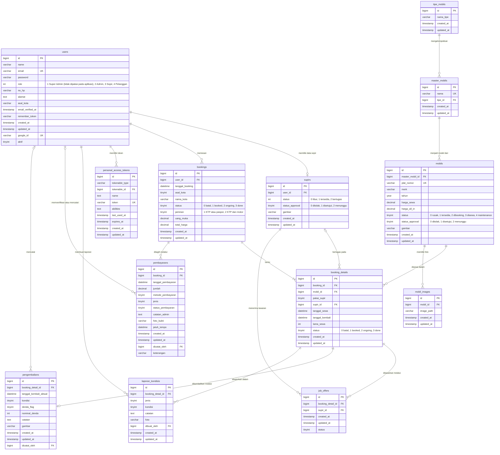

# Entity Relationship Diagram (ERD)
# Sistem Informasi Manajemen Rental Mobil Harkat Yogyakarta (Aplikasi Mobile Flutter + RESTful API Laravel)

> **Versi:** 1.0 | **Tanggal:** 7 Oktober 2026
> **Penulis:** Betrand Alfayedh
> **Sumber:** skema basis data MySQL setelah seluruh migrasi dijalankan (dibaca langsung dari `information_schema`), bukan dari ingatan.
> **Dokumen pasangan:** [class-diagram.md](class-diagram.md)

---

## 1. Cakupan

ERD ini memuat **13 tabel** yang dipakai oleh aplikasi mobile melalui RESTful API. Tabel berikut ada pada basis data tetapi **tidak dimasukkan** karena tidak dipakai oleh API aplikasi mobile:

| Tabel | Alasan dikecualikan |
|-------|---------------------|
| `transaksis` | Tabel lama dari sistem web sebelum pemesanan dipisah menjadi `bookings` dan `booking_details`; tidak dibaca maupun ditulis oleh API |
| `approvals` | Riwayat persetujuan perubahan data pada sistem web (Super Admin berada di luar lingkup tugas akhir); API hanya membaca kolom `status_approval` pada `supirs` dan `mobils` |
| `cities` | Daftar kota untuk sistem web; aplikasi mobile menyimpan asal kota sebagai teks |
| `cache`, `cache_locks`, `jobs`, `job_batches`, `failed_jobs`, `sessions`, `password_reset_tokens`, `migrations` | Tabel bawaan kerangka kerja Laravel |

---

## 2. Diagram ERD

Notasi *crow's foot*: `||` tepat satu, `o|` nol atau satu, `o{` nol atau banyak, `|{` satu atau banyak. Sandi pada atribut: **PK** kunci utama, **FK** kunci tamu, **UK** nilai unik.

**Catatan kardinalitas.**

- `users` ke `supirs` digambarkan nol atau satu: setiap sopir adalah satu pengguna berperan Sopir, dan satu pengguna hanya memiliki satu data sopir. Aturan ini dijaga oleh aplikasi (kolom `user_id` tidak diberi indeks unik di basis data).
- `booking_details` ke `pengembalians` digambarkan nol atau satu: setiap unit sewa dicatat pengembaliannya satu kali. Aturan ini dijaga oleh `PengembalianService` yang menolak pencatatan ganda.
- `booking_details` ke `laporan_kondisis`: paling banyak dua laporan per unit, yaitu satu sebelum dan satu sesudah sewa (jenis 1 dan 2). Pencatatan ulang memperbarui laporan yang ada.
- Indeks unik gabungan `(booking_detail_id, jenis)` pada `laporan_kondisis` menjamin satu unit sewa hanya memiliki satu laporan per jenis.
- `booking_details.supir_id` kosong sampai ada sopir yang menerima tawaran, sehingga relasinya `|o--o{`.
- `personal_access_tokens` terhubung ke `users` secara polimorfik (`tokenable_type` dan `tokenable_id`), bukan melalui kunci tamu di basis data.

---

## 3. Kamus Data

Tipe, nullability, dan kunci di bawah ini dibaca otomatis dari basis data. Kolom **Null** berisi *ya* bila boleh kosong.

### 3.1 Tabel `users` — Pengguna

Seluruh pengguna aplikasi (pelanggan, admin, dan sopir). Peran dibedakan oleh kolom role.

| No | Kolom | Tipe | Null | Kunci | Keterangan |
|----|-------|------|------|-------|------------|
| 1 | `id` | bigint unsigned | tidak | PK | Kunci utama |
| 2 | `name` | varchar(255) | tidak |  | Nama lengkap |
| 3 | `email` | varchar(255) | tidak | UK | Surel untuk login (unik) |
| 4 | `password` | varchar(255) | tidak |  | Kata sandi ter-hash |
| 5 | `role` | int | tidak |  | Peran: 1 Super Admin (tidak dipakai pada aplikasi), 2 Admin, 3 Sopir, 4 Pelanggan |
| 6 | `no_hp` | varchar(255) | ya |  | Nomor telepon |
| 7 | `alamat` | text | ya |  | Alamat |
| 8 | `asal_kota` | varchar(255) | ya |  | Asal kota pengguna |
| 9 | `email_verified_at` | timestamp | ya |  | Waktu verifikasi surel |
| 10 | `remember_token` | varchar(100) | ya |  | Token sesi web (tidak dipakai aplikasi mobile) |
| 11 | `created_at` | timestamp | ya |  | Waktu dibuat |
| 12 | `updated_at` | timestamp | ya |  | Waktu diubah |
| 13 | `google_id` | varchar(255) | ya | UK | Identitas akun Google bila masuk dengan Google (unik) |
| 14 | `aktif` | tinyint(1) | tidak |  | 1 aktif, 0 dinonaktifkan (tidak dapat login) |

### 3.2 Tabel `supirs` — Sopir

Data khusus sopir. Nama, surel, dan nomor telepon sopir disimpan pada users.

| No | Kolom | Tipe | Null | Kunci | Keterangan |
|----|-------|------|------|-------|------------|
| 1 | `id` | bigint unsigned | tidak | PK | Kunci utama |
| 2 | `user_id` | bigint unsigned | tidak | FK → `users.id` | Pengguna pemilik data sopir |
| 3 | `status` | int | tidak |  | Ketersediaan: 0 libur, 1 tersedia, 2 bertugas |
| 4 | `status_approval` | tinyint | tidak |  | Persetujuan: 0 ditolak, 1 disetujui, 2 menunggu |
| 5 | `gambar` | varchar(255) | ya |  | Foto sopir |
| 6 | `created_at` | timestamp | ya |  | Waktu dibuat |
| 7 | `updated_at` | timestamp | ya |  | Waktu diubah |

### 3.3 Tabel `tipe_mobils` — Tipe Mobil

Kategori mobil (mis. MPV, SUV).

| No | Kolom | Tipe | Null | Kunci | Keterangan |
|----|-------|------|------|-------|------------|
| 1 | `id` | bigint unsigned | tidak | PK | Kunci utama |
| 2 | `nama_tipe` | varchar(255) | tidak |  | Nama tipe |
| 3 | `created_at` | timestamp | ya |  | Waktu dibuat |
| 4 | `updated_at` | timestamp | ya |  | Waktu diubah |

### 3.4 Tabel `master_mobils` — Master Mobil

Model mobil (mis. Avanza) yang menjadi induk unit armada.

| No | Kolom | Tipe | Null | Kunci | Keterangan |
|----|-------|------|------|-------|------------|
| 1 | `id` | bigint unsigned | tidak | PK | Kunci utama |
| 2 | `nama` | varchar(255) | tidak | UK | Nama model (unik) |
| 3 | `tipe_id` | bigint unsigned | tidak | FK → `tipe_mobils.id` | Tipe mobil |
| 4 | `created_at` | timestamp | ya |  | Waktu dibuat |
| 5 | `updated_at` | timestamp | ya |  | Waktu diubah |

### 3.5 Tabel `mobils` — Mobil

Unit armada yang disewakan.

| No | Kolom | Tipe | Null | Kunci | Keterangan |
|----|-------|------|------|-------|------------|
| 1 | `id` | bigint unsigned | tidak | PK | Kunci utama |
| 2 | `master_mobil_id` | bigint unsigned | tidak | FK → `master_mobils.id` | Model mobil |
| 3 | `plat_nomor` | varchar(255) | ya | UK | Plat nomor (unik) |
| 4 | `merk` | varchar(255) | tidak |  | Merek |
| 5 | `tahun` | year | tidak |  | Tahun pembuatan |
| 6 | `harga_sewa` | decimal(10,2) | tidak |  | Tarif per hari tanpa sopir (Rp) |
| 7 | `harga_all_in` | decimal(10,2) | ya |  | Tarif per hari dengan sopir (Rp) |
| 8 | `status` | tinyint | tidak |  | Status unit: 0 rusak, 1 tersedia, 2 dibooking, 3 disewa, 4 maintenance |
| 9 | `status_approval` | tinyint | tidak |  | Persetujuan unit: 0 ditolak, 1 disetujui, 2 menunggu |
| 10 | `gambar` | varchar(255) | ya |  | Foto utama |
| 11 | `created_at` | timestamp | ya |  | Waktu dibuat |
| 12 | `updated_at` | timestamp | ya |  | Waktu diubah |

### 3.6 Tabel `mobil_images` — Foto Mobil

Galeri foto tambahan unit.

| No | Kolom | Tipe | Null | Kunci | Keterangan |
|----|-------|------|------|-------|------------|
| 1 | `id` | bigint unsigned | tidak | PK | Kunci utama |
| 2 | `mobil_id` | bigint unsigned | tidak | FK → `mobils.id` | Unit mobil |
| 3 | `image_path` | varchar(255) | tidak |  | Lokasi berkas foto |
| 4 | `created_at` | timestamp | ya |  | Waktu dibuat |
| 5 | `updated_at` | timestamp | ya |  | Waktu diubah |

### 3.7 Tabel `bookings` — Pesanan

Satu pesanan milik satu pelanggan; dapat berisi beberapa unit sewa.

| No | Kolom | Tipe | Null | Kunci | Keterangan |
|----|-------|------|------|-------|------------|
| 1 | `id` | bigint unsigned | tidak | PK | Kunci utama |
| 2 | `user_id` | bigint unsigned | tidak | FK → `users.id` | Pelanggan pemesan |
| 3 | `tanggal_booking` | datetime | tidak |  | Waktu pesanan dibuat |
| 4 | `asal_kota` | tinyint | tidak |  | 1 Yogyakarta, selain itu luar kota |
| 5 | `nama_kota` | varchar(255) | ya |  | Nama kota bila luar Yogyakarta |
| 6 | `status` | tinyint | tidak |  | Status pesanan: 0 batal, 1 booked, 2 ongoing, 3 done |
| 7 | `jaminan` | tinyint | tidak |  | Jaminan: 1 KTP atau paspor, 2 KTP dan motor |
| 8 | `uang_muka` | decimal(15,2) | tidak |  | Nominal uang muka (DP) 50% dari total (Rp) |
| 9 | `total_harga` | decimal(15,2) | tidak |  | Total biaya sewa (Rp) |
| 10 | `created_at` | timestamp | ya |  | Waktu dibuat |
| 11 | `updated_at` | timestamp | ya |  | Waktu diubah |

### 3.8 Tabel `booking_details` — Unit Sewa

Satu unit mobil dalam satu pesanan beserta jadwalnya.

| No | Kolom | Tipe | Null | Kunci | Keterangan |
|----|-------|------|------|-------|------------|
| 1 | `id` | bigint unsigned | tidak | PK | Kunci utama |
| 2 | `booking_id` | bigint unsigned | tidak | FK → `bookings.id` | Pesanan induk |
| 3 | `mobil_id` | bigint unsigned | tidak | FK → `mobils.id` | Unit mobil yang disewa |
| 4 | `pakai_supir` | tinyint | tidak |  | 1 memakai sopir, 0 lepas kunci |
| 5 | `supir_id` | bigint unsigned | ya | FK → `supirs.id` | Sopir yang bertugas (kosong sebelum ada yang menerima) |
| 6 | `tanggal_sewa` | datetime | tidak |  | Waktu mulai sewa |
| 7 | `tanggal_kembali` | datetime | tidak |  | Waktu kembali yang dijadwalkan |
| 8 | `lama_sewa` | int | tidak |  | Lama sewa dalam hari (dibulatkan ke atas per 24 jam) |
| 9 | `status` | tinyint | tidak |  | Status unit: 0 batal, 1 booked, 2 ongoing, 3 done |
| 10 | `created_at` | timestamp | ya |  | Waktu dibuat |
| 11 | `updated_at` | timestamp | ya |  | Waktu diubah |

### 3.9 Tabel `pembayarans` — Pembayaran

Tagihan dan pembayaran suatu pesanan: uang muka, pelunasan, dan tagihan denda.

| No | Kolom | Tipe | Null | Kunci | Keterangan |
|----|-------|------|------|-------|------------|
| 1 | `id` | bigint unsigned | tidak | PK | Kunci utama |
| 2 | `booking_id` | bigint unsigned | tidak | FK → `bookings.id` | Pesanan yang ditagih |
| 3 | `tanggal_pembayaran` | datetime | ya |  | Waktu pembayaran dinyatakan lunas |
| 4 | `jumlah` | decimal(12,2) | tidak |  | Nominal tagihan (Rp) |
| 5 | `metode_pembayaran` | tinyint | ya |  | 1 tunai, 2 transfer, 3 QRIS |
| 6 | `jenis` | tinyint | tidak |  | 1 uang muka (DP), 2 pelunasan (termasuk denda) |
| 7 | `status_pembayaran` | tinyint | tidak |  | 0 belum bayar, 2 menunggu verifikasi, 1 lunas |
| 8 | `catatan_admin` | text | ya |  | Alasan penolakan bukti dari admin |
| 9 | `foto_bukti` | varchar(255) | ya |  | Berkas bukti pembayaran |
| 10 | `jatuh_tempo` | datetime | ya |  | Batas waktu pembayaran |
| 11 | `created_at` | timestamp | ya |  | Waktu dibuat |
| 12 | `updated_at` | timestamp | ya |  | Waktu diubah |
| 13 | `dicatat_oleh` | bigint unsigned | ya | FK → `users.id` | Admin yang memverifikasi atau mencatat |
| 14 | `keterangan` | varchar(255) | ya |  | Keterangan tagihan (mis. Denda keterlambatan) |

### 3.10 Tabel `pengembalians` — Pengembalian

Pencatatan kembalinya satu unit sewa beserta kondisi dan denda.

| No | Kolom | Tipe | Null | Kunci | Keterangan |
|----|-------|------|------|-------|------------|
| 1 | `id` | bigint unsigned | tidak | PK | Kunci utama |
| 2 | `booking_detail_id` | bigint unsigned | tidak | FK → `booking_details.id` | Unit sewa yang dikembalikan |
| 3 | `tanggal_kembali_aktual` | datetime | tidak |  | Waktu kembali sebenarnya |
| 4 | `kondisi` | tinyint | tidak |  | 1 baik, 0 rusak |
| 5 | `denda_flag` | tinyint | tidak |  | 1 bila terlambat dan terkena denda |
| 6 | `nominal_denda` | int | tidak |  | Denda Rp50.000 per jam yang sudah dimulai (Rp) |
| 7 | `catatan` | text | ya |  | Catatan kondisi |
| 8 | `gambar` | varchar(255) | ya |  | Foto kondisi |
| 9 | `created_at` | timestamp | ya |  | Waktu dibuat |
| 10 | `updated_at` | timestamp | ya |  | Waktu diubah |
| 11 | `dicatat_oleh` | bigint unsigned | ya | FK → `users.id` | Admin yang mencatat |

### 3.11 Tabel `job_offers` — Tawaran Tugas

Tawaran tugas sopir untuk satu unit sewa yang memakai sopir.

| No | Kolom | Tipe | Null | Kunci | Keterangan |
|----|-------|------|------|-------|------------|
| 1 | `id` | bigint unsigned | tidak | PK | Kunci utama |
| 2 | `booking_detail_id` | bigint unsigned | tidak | FK → `booking_details.id` | Unit sewa yang ditawarkan |
| 3 | `supir_id` | bigint unsigned | tidak | FK → `supirs.id` | Sopir penerima tawaran |
| 4 | `created_at` | timestamp | ya |  | Waktu dibuat |
| 5 | `updated_at` | timestamp | ya |  | Waktu diubah |
| 6 | `status` | tinyint | tidak |  | 0 terbuka, 1 diterima, 2 ditutup, 3 ditolak |

### 3.12 Tabel `laporan_kondisis` — Laporan Kondisi

Laporan kondisi kendaraan sebelum atau sesudah sewa oleh sopir atau admin.

| No | Kolom | Tipe | Null | Kunci | Keterangan |
|----|-------|------|------|-------|------------|
| 1 | `id` | bigint unsigned | tidak | PK | Kunci utama |
| 2 | `booking_detail_id` | bigint unsigned | tidak | FK → `booking_details.id` | Unit sewa yang dilaporkan |
| 3 | `jenis` | tinyint unsigned | tidak |  | 1 sebelum sewa, 2 sesudah sewa |
| 4 | `kondisi` | tinyint unsigned | tidak |  | 1 baik, 2 lecet atau perlu perhatian, 3 rusak |
| 5 | `catatan` | text | ya |  | Catatan |
| 6 | `foto` | varchar(255) | ya |  | Foto kondisi |
| 7 | `dibuat_oleh` | bigint unsigned | tidak | FK → `users.id` | Pengguna pembuat laporan |
| 8 | `created_at` | timestamp | ya |  | Waktu dibuat |
| 9 | `updated_at` | timestamp | ya |  | Waktu diubah |

### 3.13 Tabel `personal_access_tokens` — Token Akses

Token Sanctum yang diterbitkan saat login (berlaku 7 hari). Pemilik token diacu secara polimorfik ke users.

| No | Kolom | Tipe | Null | Kunci | Keterangan |
|----|-------|------|------|-------|------------|
| 1 | `id` | bigint unsigned | tidak | PK | Kunci utama |
| 2 | `tokenable_type` | varchar(255) | tidak |  | Kelas pemilik token (App\Models\User) |
| 3 | `tokenable_id` | bigint unsigned | tidak |  | ID pemilik token |
| 4 | `name` | text | tidak |  | Nama token |
| 5 | `token` | varchar(64) | tidak | UK | Hash token (unik) |
| 6 | `abilities` | text | ya |  | Hak akses token: customer, admin, atau sopir |
| 7 | `last_used_at` | timestamp | ya |  | Terakhir dipakai |
| 8 | `expires_at` | timestamp | ya |  | Waktu kedaluwarsa |
| 9 | `created_at` | timestamp | ya |  | Waktu dibuat |
| 10 | `updated_at` | timestamp | ya |  | Waktu diubah |

---

## 4. Perilaku Penghapusan (Kunci Tamu)

| Tabel | Kolom | Mengacu ke | Bila data induk dihapus |
|-------|-------|-----------|-------------------------|
| `supirs` | `user_id` | `users` | ikut dihapus |
| `master_mobils` | `tipe_id` | `tipe_mobils` | ikut dihapus |
| `mobils` | `master_mobil_id` | `master_mobils` | ikut dihapus |
| `mobil_images` | `mobil_id` | `mobils` | ikut dihapus |
| `bookings` | `user_id` | `users` | ikut dihapus |
| `booking_details` | `booking_id` | `bookings` | ikut dihapus |
| `booking_details` | `mobil_id` | `mobils` | ikut dihapus |
| `booking_details` | `supir_id` | `supirs` | kolom dikosongkan |
| `pembayarans` | `booking_id` | `bookings` | ikut dihapus |
| `pembayarans` | `dicatat_oleh` | `users` | kolom dikosongkan |
| `pengembalians` | `booking_detail_id` | `booking_details` | ikut dihapus |
| `pengembalians` | `dicatat_oleh` | `users` | kolom dikosongkan |
| `job_offers` | `booking_detail_id` | `booking_details` | ikut dihapus |
| `job_offers` | `supir_id` | `supirs` | ikut dihapus |
| `laporan_kondisis` | `booking_detail_id` | `booking_details` | ikut dihapus |
| `laporan_kondisis` | `dibuat_oleh` | `users` | penghapusan ditolak |

> Dalam praktik, mobil dan pengguna tidak dihapus secara fisik bila sudah pernah dipakai: `MobilApiController` menolak penghapusan unit yang pernah disewa, dan akun sopir dinonaktifkan melalui kolom `aktif`.

---

## 5. Aturan Status dan Hubungan Antartabel

| Aturan | Dijaga oleh |
|--------|-------------|
| Ketersediaan mobil ditentukan oleh tumpang tindih tanggal pada `booking_details` yang masih aktif, bukan oleh kolom `mobils.status` saja | `BookingService` (dengan penguncian baris mobil di dalam transaksi) |
| Total biaya dibulatkan ke atas per 24 jam; uang muka 50% disimpan pada `bookings.uang_muka` dan ditagih sebagai `pembayarans` berjenis 1 | `BookingService` |
| Pembayaran berstatus 0 yang melewati `jatuh_tempo` membuat pesanan dibatalkan otomatis | perintah terjadwal `booking:check-dp` (tiap 5 menit) |
| Tawaran tugas hanya dibuat untuk unit `pakai_supir = 1`; satu tawaran berstatus diterima menutup tawaran lain | `PenugasanService` |
| Pesanan menjadi Done bila seluruh unitnya telah dikembalikan; denda keterlambatan ditambahkan ke tagihan pelunasan yang belum dibayar, atau dibuat sebagai tagihan terpisah berketerangan *Denda keterlambatan* | `PengembalianService` |
| Setelah dikembalikan, `mobils.status` menjadi 4 (maintenance) bila kondisi baik atau 0 (rusak) bila rusak | `PengembalianService` |

