# Sequence Diagram — Versi Laporan (Standar ECB)
# E-Tourism Information System — CV Kopi Danau Atas

> **Version:** 2.4 (5 pasangan SD digabung — SD-2/4/17/18/20 pensiun, terserap ke SD-1/3/16/22/19 — menyusul use case diagram v1.5) · 2.3 (SD-7 & SD-26 dihapus) · 2.2 (menambahkan SD-41 Lihat Halaman Tentang Kami) · 2.1 (versi Mermaid untuk setiap SD) | **Date:** 14 Juli 2026
> **Author:** Fadhil Dzaky Arhab — 2301092010
> **Standar acuan:** pola sequence diagram pada laporan referensi (`docs/Revisi-LAPORAN TA-Nina Widianti.docx`): notasi **ECB (Entity–Control–Boundary)** ala Enterprise Architect — Aktor (stick figure), Halaman (*boundary*), Controller (*control*), tabel basis data (*entity*).

---

## 1. Pendahuluan

Dokumen ini berisi **sequence diagram untuk setiap use case** (32 diagram, SD-1 s/d SD-41 mengikuti nomor use case; UC2, UC4, UC7, UC17, UC18, UC20, UC23, UC24, UC26 tidak ada — sebagian dihapus, sebagian digabung ke use case lain pada revisi use case v1.4–v1.5). Ciri standar yang diikuti:

1. **Lifeline ECB** — Aktor → Halaman (boundary) → Controller (control) → tabel basis data (entity); sistem eksternal (Midtrans, Google, Server Email) sebagai participant.
2. **Fragmen `alt`** untuk mengelompokkan operasi dan percabangan (guard ditulis dalam `[kurung siku]`).
3. **Konvensi pesan** — semua pesan diakhiri `()`: aksi pengguna, request HTTP, query SQL; respons berupa garis putus-putus.
4. **Activation bar** pada setiap siklus request–response.

Setiap diagram disajikan dalam dua format: **Mermaid** (alternatif yang mudah dirender langsung; Mermaid tidak punya simbol ECB sehingga stereotipe ditulis sebagai teks «boundary» / «control» / «entity» pada nama lifeline) dan **PlantUML** (versi standar laporan karena mendukung simbol `boundary` / `control` / `entity`). Render PlantUML via ekstensi PlantUML di VS Code, [plantuml.com/plantuml](https://www.plantuml.com/plantuml), atau kroki.io. Bila renderer mendukung, baris `title sd ...` dapat diganti `mainframe sd ...` agar bingkai pentagon "sd" persis seperti Enterprise Architect.

**Penomoran.** ID sequence diagram **sama dengan nomor use case-nya** (SD-16 = sequence untuk UC16) dan sejajar dengan activity diagram (AD-16).

**Penempatan pada laporan** (mengikuti laporan referensi — fitur utama di BAB III, sisanya di Lampiran):

- **📌 BAB III** — SD-16, SD-22, SD-27, SD-37, SD-14 (5 fitur utama).
- **📎 Lampiran** — 27 diagram lainnya.

### 1.1 Daftar Sequence Diagram

| ID | Nama Alur | Aktor | Penempatan |
|----|-----------|-------|------------|
| **Akses Publik** | | | |
| SD-8 | Lihat Daftar Paket Wisata | Pengunjung | 📎 Lampiran |
| SD-9 | Lihat Detail Paket Wisata | Pengunjung | 📎 Lampiran |
| SD-40 | Cari & Filter Paket Wisata | Pengunjung | 📎 Lampiran |
| SD-10 | Lihat Daftar & Detail Blog | Pengunjung | 📎 Lampiran |
| SD-11 | Cek Kuota Real-time | Pengunjung | 📎 Lampiran |
| SD-12 | Ganti Bahasa (ID/EN) | Pengunjung | 📎 Lampiran |
| SD-13 | Lihat Lokasi Google Maps | Pengunjung | 📎 Lampiran |
| SD-36 | Lihat Review Pengunjung | Pengunjung | 📎 Lampiran |
| SD-41 | Lihat Halaman Tentang Kami | Pengunjung | 📎 Lampiran |
| **Autentikasi** | | | |
| SD-1 | Registrasi Akun & Verifikasi Email | Pengunjung | 📎 Lampiran |
| SD-3 | Login Email/Password & Login via Google OAuth | Pengunjung | 📎 Lampiran |
| SD-5 | Lupa & Reset Password | Pengunjung | 📎 Lampiran |
| SD-6 | Logout | Wisatawan/Admin | 📎 Lampiran |
| **Booking & Pembayaran** | | | |
| SD-16 | Pemesanan Paket Wisata (Buat Booking, termasuk Review Order) | Wisatawan | 📌 **BAB III** |
| SD-22 | Pembayaran via Midtrans Snap & Cek Status Pembayaran | Wisatawan | 📌 **BAB III** |
| SD-21 | Lihat Riwayat Booking | Wisatawan | 📎 Lampiran |
| SD-19 | Lihat E-Ticket & Unduh Invoice PDF | Wisatawan | 📎 Lampiran |
| SD-38 | Batalkan Booking | Wisatawan | 📎 Lampiran |
| **Interaksi Wisatawan** | | | |
| SD-14 | Ulasan Paket Wisata (Tulis Review) | Wisatawan | 📌 **BAB III** |
| SD-15 | Kelola Akun Sendiri | Wisatawan | 📎 Lampiran |
| **Manajemen (Admin Panel)** | | | |
| SD-25 | Login Admin | Admin | 📎 Lampiran |
| SD-27 | Mengelola Paket Wisata & Kategori | Admin | 📌 **BAB III** |
| SD-28 | Validasi & Ubah Status Booking | Admin | 📎 Lampiran |
| SD-29 | Pantau Pembayaran | Admin | 📎 Lampiran |
| SD-30 | Mengelola Blog & Kategori | Admin | 📎 Lampiran |
| SD-31 | Inspeksi & Hapus Review | Admin | 📎 Lampiran |
| SD-32 | Mengelola Konten Homepage | Admin | 📎 Lampiran |
| SD-33 | Mengelola Coffee Varieties | Admin | 📎 Lampiran |
| SD-34 | Mengelola Pengguna | Admin | 📎 Lampiran |
| SD-35 | Mengelola Site Settings | Admin | 📎 Lampiran |
| SD-37 | Check-in E-Tiket | Admin | 📌 **BAB III** |
| SD-39 | Refund Pembayaran | Admin | 📎 Lampiran |

---

# Bagian A — Akses Publik

## SD-8 — Lihat Daftar Paket Wisata (UC8) — 📎 Lampiran

Sequence diagram ini menggambarkan pengunjung membuka daftar paket wisata yang aktif.

### Diagram (Mermaid)

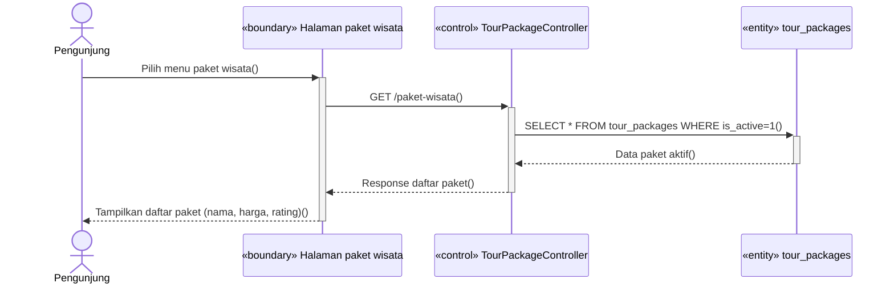

### Diagram (PlantUML)

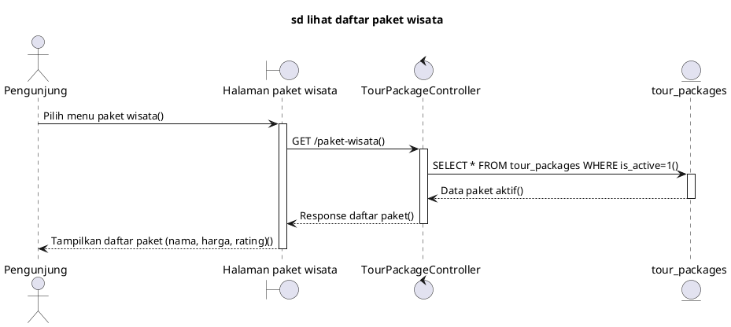

---

## SD-9 — Lihat Detail Paket Wisata (UC9) — 📎 Lampiran

Sequence diagram ini menggambarkan pengunjung membuka detail satu paket wisata beserta ulasannya.

### Diagram (Mermaid)

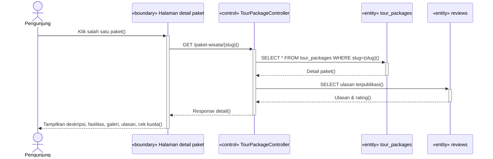

### Diagram (PlantUML)

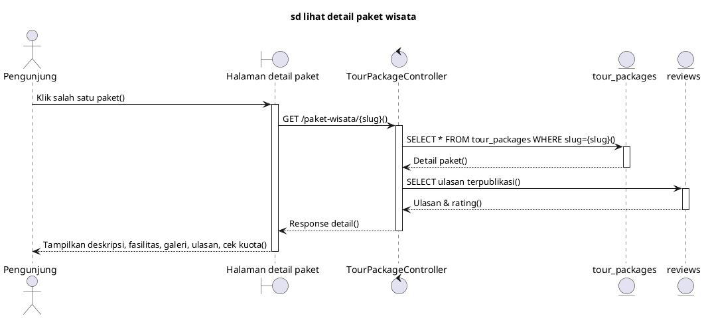

---

## SD-40 — Cari & Filter Paket Wisata (UC40) — 📎 Lampiran

Sequence diagram ini menggambarkan pencarian paket dengan kata kunci, kategori, rentang harga, dan urutan.

### Diagram (Mermaid)

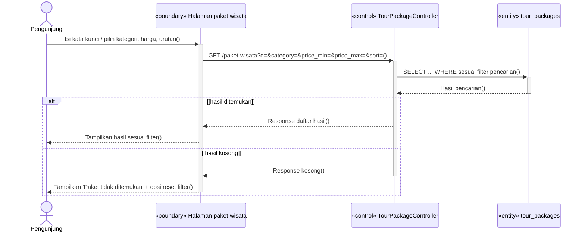

### Diagram (PlantUML)

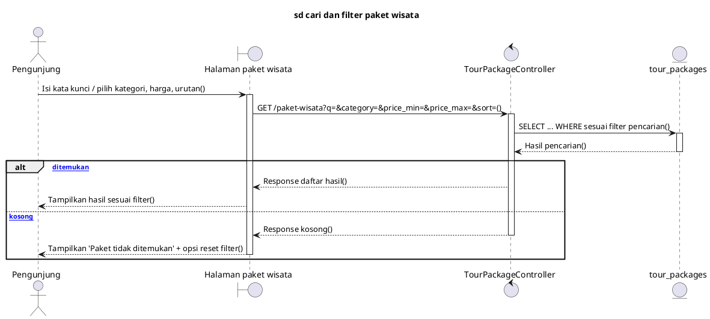

---

## SD-10 — Lihat Daftar & Detail Blog (UC10) — 📎 Lampiran

Sequence diagram ini menggambarkan pengunjung membaca artikel blog.

### Diagram (Mermaid)

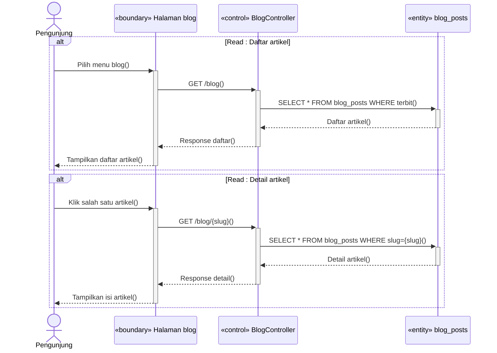

### Diagram (PlantUML)

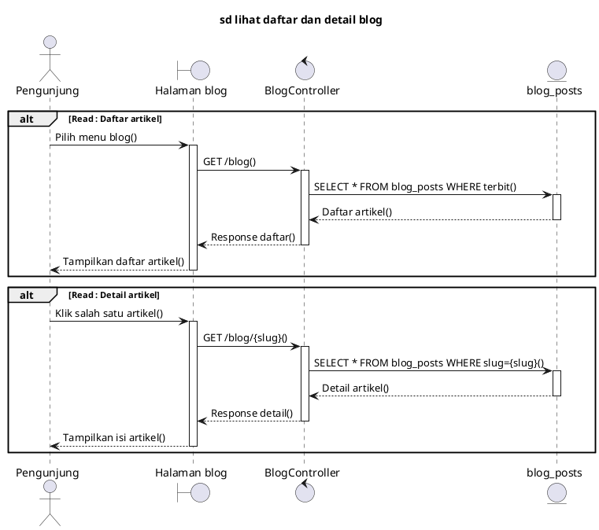

---

## SD-11 — Cek Kuota Real-time (UC11) — 📎 Lampiran

Sequence diagram ini menggambarkan pengecekan sisa kuota saat pengunjung memilih tanggal kunjungan pada form booking.

### Diagram (Mermaid)

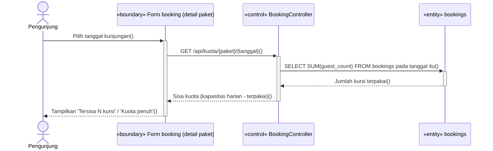

### Diagram (PlantUML)

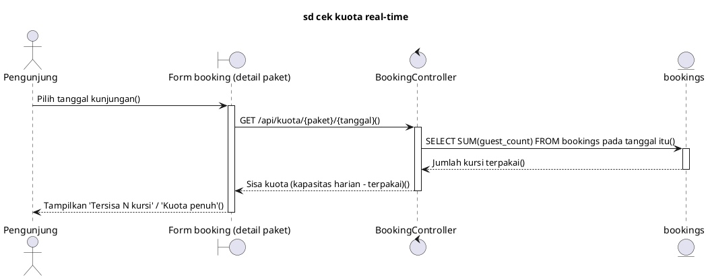

---

## SD-12 — Ganti Bahasa ID/EN (UC12) — 📎 Lampiran

Sequence diagram ini menggambarkan penggantian bahasa antarmuka situs.

### Diagram (Mermaid)

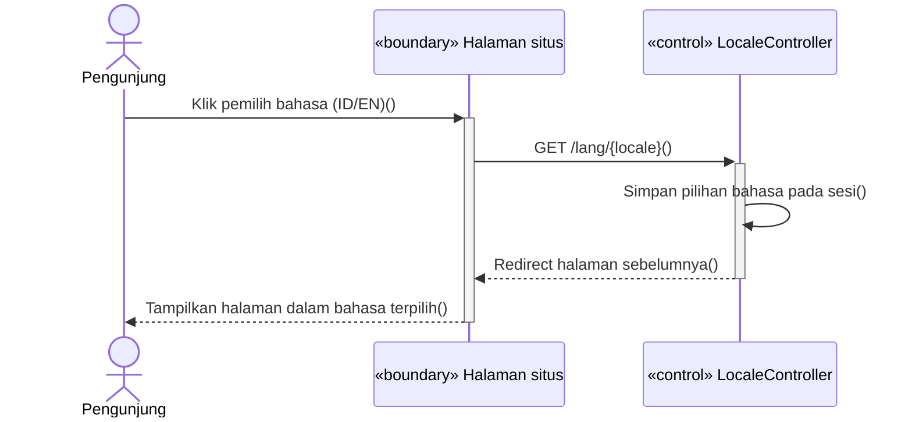

### Diagram (PlantUML)

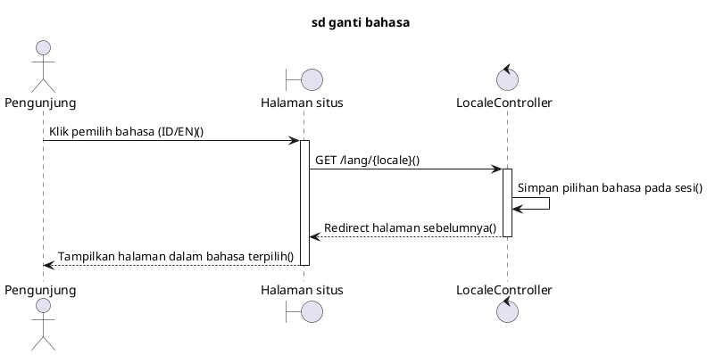

---

## SD-41 — Lihat Halaman Tentang Kami (UC41) — 📎 Lampiran

Sequence diagram ini menggambarkan pengunjung membuka halaman Tentang Kami yang menampilkan profil perusahaan, varietas kopi, galeri foto, dan lokasi.

### Diagram (Mermaid)

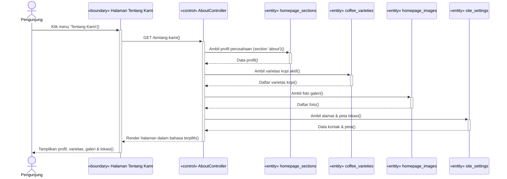

### Diagram (PlantUML)

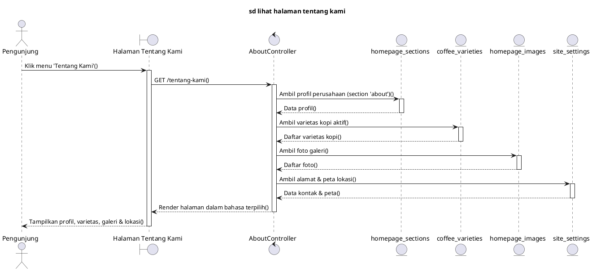

---

## SD-13 — Lihat Lokasi Google Maps (UC13) — 📎 Lampiran

Sequence diagram ini menggambarkan pengunjung melihat lokasi pada peta tersemat di beranda.

### Diagram (Mermaid)

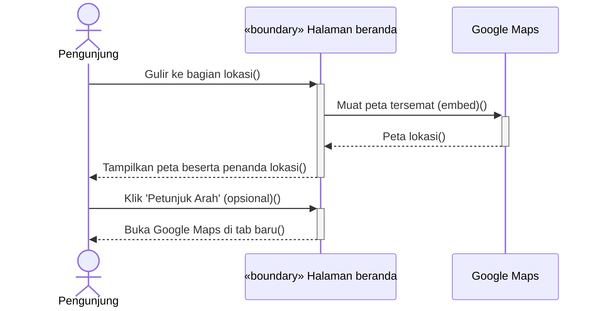

### Diagram (PlantUML)

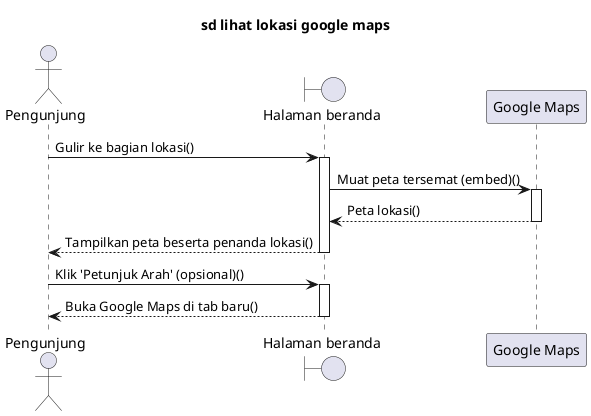

---

## SD-36 — Lihat Review Pengunjung (UC36) — 📎 Lampiran

Sequence diagram ini menggambarkan tampilnya ulasan terpublikasi di beranda dan halaman detail paket.

### Diagram (Mermaid)

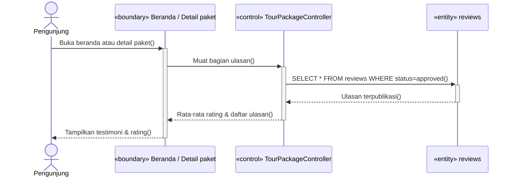

### Diagram (PlantUML)

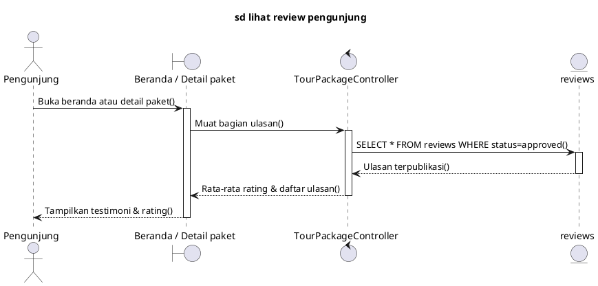

---

# Bagian B — Autentikasi

## SD-1 — Registrasi Akun & Verifikasi Email (UC1) — 📎 Lampiran

Sequence diagram ini menggambarkan pembuatan akun baru dengan email dan kata sandi (sistem mengirim tautan verifikasi), dilanjutkan verifikasi email melalui tautan bertanda tangan yang dikirim sistem — dua siklus request-response terpisah waktu (pengguna sempat membuka aplikasi email di luar sistem).

### Diagram (Mermaid)

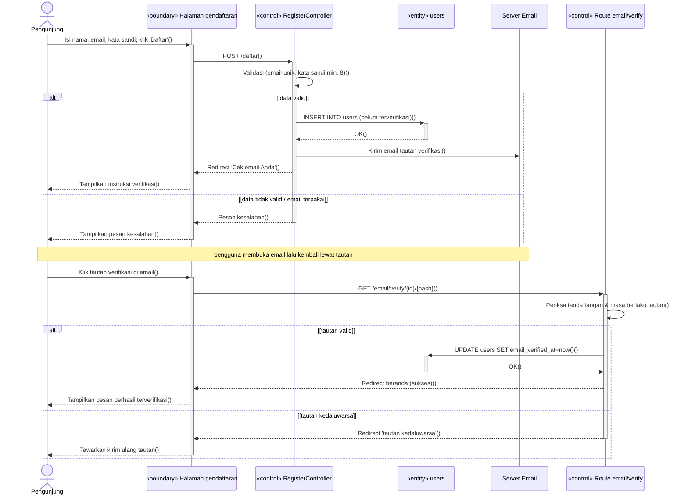

### Diagram (PlantUML)

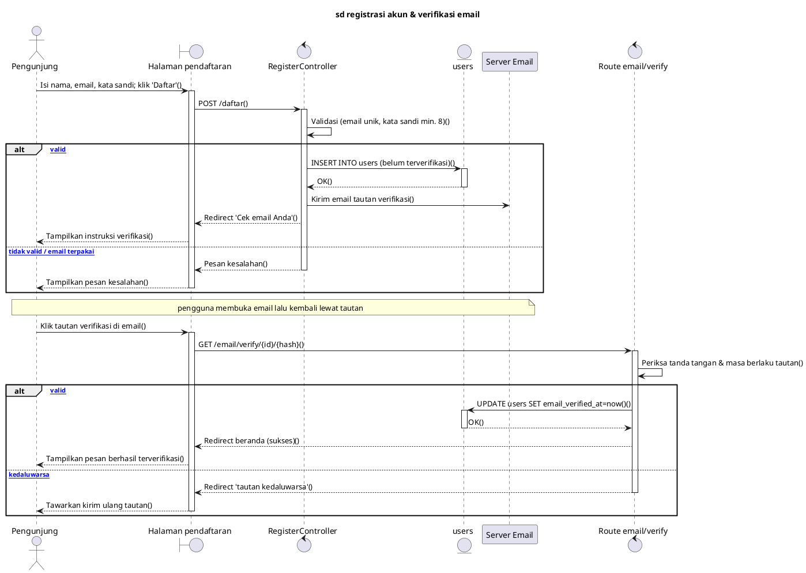

> **Catatan.** Sejak v2.4, verifikasi email (dulu UC2/SD-2 terpisah, relasi `<<include>>` UC1→UC2) digambar menyatu di sini sebagai siklus request-response kedua, dipisah `Note` karena pengguna meninggalkan sistem sejenak untuk membuka email.

---

## SD-3 — Login Email/Password & Login via Google OAuth (UC3) — 📎 Lampiran

Sequence diagram ini menggambarkan proses masuk lewat dua metode: email/kata sandi, atau akun Google (akun lama ditautkan atau akun baru dibuat otomatis terverifikasi).

### Diagram (Mermaid)

```mermaid
sequenceDiagram
    actor P as Pengunjung
    participant H as «boundary» Halaman masuk
    participant C as «control» LoginController
    participant GC as «control» GoogleController
    participant G as Google OAuth
    participant E as «entity» users

    alt [metode: Email/Password]
        P->>+H: Isi email & kata sandi, klik 'Masuk'()
        H->>+C: POST /masuk()
        C->>+E: SELECT * FROM users WHERE email={email}()
        E-->>-C: Data akun()
        alt [kredensial cocok & email terverifikasi]
            C->>C: Buat sesi login()
            C-->>H: Redirect beranda()
            H-->>P: Tampilkan beranda (sudah masuk)()
        else [gagal / belum terverifikasi]
            C-->>-H: Pesan kesalahan / arahkan verifikasi()
            H-->>-P: Tampilkan pesan()
        end
    else [metode: Google]
        P->>+H: Klik 'Masuk dengan Google'()
        H->>+GC: GET /auth/google/redirect()
        GC-->>-H: Alihkan ke halaman persetujuan Google()
        P->>G: Pilih akun & setujui akses()
        G-->>H: Callback beserta kode otorisasi()
        H->>+GC: GET /auth/google/callback()
        GC->>+G: Tukar kode otorisasi dengan profil()
        G-->>-GC: Profil Google (id, email, nama)()
        GC->>+E: SELECT * FROM users WHERE email()
        E-->>-GC: Data akun (bila ada)()
        alt [email sudah terdaftar]
            GC->>E: UPDATE users — tautkan akun Google()
        else [akun baru]
            GC->>E: INSERT INTO users (otomatis terverifikasi)()
        end
        GC-->>-H: Buat sesi, redirect sesuai peran()
        H-->>-P: Tampilkan beranda / panel admin()
    end
```

### Diagram (PlantUML)

```plantuml
@startuml
title sd login email password & google oauth
actor "Pengunjung" as P
boundary "Halaman masuk" as H
control "LoginController" as C
control "GoogleController" as GC
participant "Google OAuth" as G
entity "users" as E

alt [metode: Email/Password]
    P -> H ++ : Isi email & kata sandi, klik 'Masuk'()
    H -> C ++ : POST /masuk()
    C -> E ++ : SELECT * FROM users WHERE email={email}()
    E --> C -- : Data akun()
    alt [kredensial cocok & email terverifikasi]
        C -> C : Buat sesi login()
        C --> H : Redirect beranda()
        H --> P : Tampilkan beranda (sudah masuk)()
    else [gagal / belum terverifikasi]
        C --> H -- : Pesan kesalahan / arahkan verifikasi()
        H --> P -- : Tampilkan pesan()
    end
else [metode: Google]
    P -> H ++ : Klik 'Masuk dengan Google'()
    H -> GC ++ : GET /auth/google/redirect()
    GC --> H -- : Alihkan ke halaman persetujuan Google()
    P -> G : Pilih akun & setujui akses()
    G --> H : Callback beserta kode otorisasi()
    H -> GC ++ : GET /auth/google/callback()
    GC -> G ++ : Tukar kode otorisasi dengan profil()
    G --> GC -- : Profil Google (id, email, nama)()
    GC -> E ++ : SELECT * FROM users WHERE email()
    E --> GC -- : Data akun (bila ada)()
    alt [email sudah terdaftar]
        GC -> E : UPDATE users — tautkan akun Google()
    else [akun baru]
        GC -> E : INSERT INTO users (otomatis terverifikasi)()
    end
    GC --> H -- : Buat sesi, redirect sesuai peran()
    H --> P -- : Tampilkan beranda / panel admin()
end
@enduml
```

> **Catatan.** Sejak v2.4, Login via Google OAuth (dulu UC4/SD-4 terpisah, relasi `<<extend>>` UC4→UC3) digambar menyatu di sini sebagai cabang `alt` kedua — kedua metode login tetap punya controller berbeda (`LoginController` vs `GoogleController`) sehingga masing-masing lifeline dipertahankan.

---

## SD-5 — Lupa & Reset Password (UC5) — 📎 Lampiran

Sequence diagram ini menggambarkan permintaan tautan reset kata sandi dan penetapan kata sandi baru.

### Diagram (Mermaid)

```mermaid
sequenceDiagram
    actor P as Pengunjung
    participant H as «boundary» Halaman lupa password
    participant FC as «control» ForgotPasswordController
    participant RC as «control» ResetPasswordController
    participant E as «entity» users
    participant M as Server Email

    alt Minta tautan reset
        P->>+H: Isi email, klik 'Kirim Tautan Reset'()
        H->>+FC: POST /lupa-password()
        FC->>+E: SELECT * FROM users WHERE email()
        E-->>-FC: Data akun()
        alt [terdaftar & punya kata sandi lokal]
            FC->>M: Kirim email tautan reset (berlaku terbatas)()
            FC-->>H: 'Tautan reset telah dikirim'()
            H-->>P: Tampilkan pesan sukses()
        else [tidak ditemukan / akun Google]
            FC-->>-H: Pesan kesalahan()
            H-->>-P: Tampilkan pesan()
        end
    end

    alt Setel ulang kata sandi
        P->>+H: Klik tautan reset, isi kata sandi baru()
        H->>+RC: POST /reset-password()
        RC->>RC: Periksa token & validasi kata sandi()
        alt [token valid]
            RC->>+E: UPDATE users SET password (terenkripsi)()
            E-->>-RC: OK()
            RC-->>H: Redirect halaman masuk (sukses)()
            H-->>P: Tampilkan pesan berhasil()
        else [token kedaluwarsa]
            RC-->>-H: Pesan 'tautan tidak valid'()
            H-->>-P: Tampilkan pesan()
        end
    end
```

### Diagram (PlantUML)

```plantuml
@startuml
title sd lupa dan reset password
actor "Pengunjung" as P
boundary "Halaman lupa password" as H
control "ForgotPasswordController" as FC
control "ResetPasswordController" as RC
entity "users" as E
participant "Server Email" as M

alt Minta tautan reset
    P -> H ++ : Isi email, klik 'Kirim Tautan Reset'()
    H -> FC ++ : POST /lupa-password()
    FC -> E ++ : SELECT * FROM users WHERE email()
    E --> FC -- : Data akun()
    alt [terdaftar & punya kata sandi lokal]
        FC -> M : Kirim email tautan reset (berlaku terbatas)()
        FC --> H : 'Tautan reset telah dikirim'()
        H --> P : Tampilkan pesan sukses()
    else [tidak ditemukan / akun Google]
        FC --> H -- : Pesan kesalahan()
        H --> P -- : Tampilkan pesan()
    end
end

alt Setel ulang kata sandi
    P -> H ++ : Klik tautan reset, isi kata sandi baru()
    H -> RC ++ : POST /reset-password()
    RC -> RC : Periksa token & validasi kata sandi()
    alt [token valid]
        RC -> E ++ : UPDATE users SET password (terenkripsi)()
        E --> RC -- : OK()
        RC --> H : Redirect halaman masuk (sukses)()
        H --> P : Tampilkan pesan berhasil()
    else [token kedaluwarsa]
        RC --> H -- : Pesan 'tautan tidak valid'()
        H --> P -- : Tampilkan pesan()
    end
end
@enduml
```

---

## SD-6 — Logout (UC6) — 📎 Lampiran

Sequence diagram ini menggambarkan pengguna keluar dari sesi login.

### Diagram (Mermaid)

```mermaid
sequenceDiagram
    actor W as Wisatawan / Admin
    participant H as «boundary» Halaman situs
    participant C as «control» LoginController

    W->>+H: Klik 'Keluar'()
    H->>+C: POST /logout()
    C->>C: Hapus sesi login()
    C-->>-H: Redirect beranda()
    H-->>-W: Tampilkan beranda (sudah keluar)()
```

### Diagram (PlantUML)

```plantuml
@startuml
title sd logout
actor "Wisatawan / Admin" as W
boundary "Halaman situs" as H
control "LoginController" as C

W -> H ++ : Klik 'Keluar'()
H -> C ++ : POST /logout()
C -> C : Hapus sesi login()
C --> H -- : Redirect beranda()
H --> W -- : Tampilkan beranda (sudah keluar)()
@enduml
```

---

# Bagian C — Booking & Pembayaran

## SD-16 — Pemesanan Paket Wisata / Buat Booking (UC16) — 📌 BAB III

Sequence diagram ini menggambarkan pembuatan booking oleh wisatawan: penyusunan ringkasan Review Order, lalu validasi data, pengecekan kuota dengan penguncian, penyimpanan booking, hingga pengarahan ke halaman pembayaran.

### Diagram (Mermaid)

```mermaid
sequenceDiagram
    actor W as Wisatawan
    participant HD as «boundary» Halaman detail paket
    participant H as «boundary» Halaman review order
    participant C as «control» BookingController
    participant TP as «entity» tour_packages
    participant BK as «entity» bookings

    W->>+HD: Pilih tanggal & jumlah tamu, klik 'Lanjutkan'()
    HD->>+C: POST /booking/create()
    C->>C: Susun ringkasan pesanan (paket, tanggal, tamu, total harga)()
    C-->>-HD: Halaman Review Order()
    HD-->>-W: Tampilkan ringkasan + form data tamu & S&K()

    W->>+H: Isi data tamu, setujui S&K, klik 'Buat Booking'()
    H->>+C: POST /booking()
    C->>C: Validasi data tamu & persetujuan S&K()
    C->>+TP: Kunci baris paket (lock)()
    TP-->>-C: Paket terkunci()
    C->>+BK: SELECT SUM(guest_count) — hitung kursi terpakai()
    BK-->>-C: Kursi terpakai()
    alt [kuota mencukupi]
        C->>+BK: INSERT INTO bookings (status=pending)()
        BK-->>-C: Kode booking (KDA-tanggal-nomor)()
        C-->>H: Response sukses()
        H-->>W: Arahkan ke halaman pembayaran()
    else [kuota tidak mencukupi]
        C-->>-H: Response gagal()
        H-->>-W: Tampilkan 'Kuota tidak mencukupi'()
    end
```

### Diagram (PlantUML)

```plantuml
@startuml
title sd pemesanan paket wisata / buat booking
actor "Wisatawan" as W
boundary "Halaman detail paket" as HD
boundary "Halaman review order" as H
control "BookingController" as C
entity "tour_packages" as TP
entity "bookings" as BK

W -> HD ++ : Pilih tanggal & jumlah tamu, klik 'Lanjutkan'()
HD -> C ++ : POST /booking/create()
C -> C : Susun ringkasan pesanan (paket, tanggal, tamu, total harga)()
C --> HD -- : Halaman Review Order()
HD --> W -- : Tampilkan ringkasan + form data tamu & S&K()

W -> H ++ : Isi data tamu, setujui S&K, klik 'Buat Booking'()
H -> C ++ : POST /booking()
C -> C : Validasi data tamu & persetujuan S&K()
C -> TP ++ : Kunci baris paket (lock)()
TP --> C -- : Paket terkunci()
C -> BK ++ : SELECT SUM(guest_count) — hitung kursi terpakai()
BK --> C -- : Kursi terpakai()
alt [kuota mencukupi]
    C -> BK ++ : INSERT INTO bookings (status=pending)()
    BK --> C -- : Kode booking (KDA-tanggal-nomor)()
    C --> H : Response sukses()
    H --> W : Arahkan ke halaman pembayaran()
else [kuota tidak mencukupi]
    C --> H -- : Response gagal()
    H --> W -- : Tampilkan 'Kuota tidak mencukupi'()
end
@enduml
```

> **Catatan.** Pengecekan kuota real-time saat memilih tanggal (UC11) digambarkan terpisah pada SD-11 (relasi `<<include>>`). Review Order (dulu UC17/SD-17 terpisah) digambar menyatu di sini sejak v2.4 sebagai siklus request-response pertama, mendahului siklus pembuatan booking.

---

## SD-22 — Pembayaran via Midtrans Snap & Cek Status Pembayaran (UC22) — 📌 BAB III

Sequence diagram ini menggambarkan alur pembayaran booking melalui Midtrans: permintaan token pembayaran, pembayaran melalui popup Snap, konfirmasi lunas via webhook (sistem memperbarui status, membangkitkan QR e-tiket, dan mengirim email konfirmasi), serta opsi wisatawan memeriksa status secara manual bila notifikasi webhook terlambat.

### Diagram (Mermaid)

```mermaid
sequenceDiagram
    actor W as Wisatawan
    participant H as «boundary» Halaman pembayaran
    participant PC as «control» PaymentController
    participant WH as «control» MidtransWebhookController
    participant M as Midtrans
    participant PAY as «entity» payments
    participant BK as «entity» bookings

    alt Minta token pembayaran
        W->>+H: Klik 'Bayar Sekarang'()
        H->>+PC: POST /booking/{id}/pay()
        PC->>+M: Minta Snap Token()
        M-->>-PC: snap_token()
        PC->>+PAY: INSERT INTO payments (status=pending)()
        PAY-->>-PC: OK()
        PC-->>-H: Response snap_token()
        H-->>-W: Tampilkan popup pembayaran Snap()
    end

    alt Proses pembayaran
        W->>+H: Pilih metode & selesaikan pembayaran()
        H->>+M: Proses pembayaran()
        M-->>-H: Pembayaran diterima()
        H-->>-W: Tampilkan halaman status booking()
    end

    alt Konfirmasi lunas (webhook)
        M->>+WH: POST /api/midtrans/notification()
        WH->>WH: Verifikasi signature()
        alt [signature valid & status settlement]
            WH->>+PAY: UPDATE payments SET status=settlement()
            PAY-->>-WH: OK()
            WH->>+BK: UPDATE bookings SET status=paid()
            BK-->>-WH: OK()
            WH->>WH: Buat QR e-tiket & kirim email konfirmasi()
            WH-->>M: 200 OK()
        else [signature tidak valid]
            WH-->>-M: 403 Invalid signature()
        end
    end

    alt Cek status manual (bila notifikasi tertunda)
        W->>+H: Klik 'Cek Status Pembayaran'()
        H->>+PC: POST /booking/{id}/update-status()
        PC->>+PAY: SELECT pembayaran terakhir()
        PAY-->>-PC: order_id()
        PC->>+M: Tanyakan status transaksi()
        M-->>-PC: Status terkini()
        PC->>PAY: UPDATE payments (jalur idempotent)()
        PC->>BK: UPDATE bookings (bila lunas)()
        PC-->>-H: Redirect detail booking()
        H-->>-W: Tampilkan 'Status diperbarui'()
    end
```

### Diagram (PlantUML)

```plantuml
@startuml
title sd pembayaran via midtrans snap & cek status pembayaran
actor "Wisatawan" as W
boundary "Halaman pembayaran" as H
control "PaymentController" as PC
control "MidtransWebhookController" as WH
participant "Midtrans" as M
entity "payments" as PAY
entity "bookings" as BK

alt Minta token pembayaran
    W -> H ++ : Klik 'Bayar Sekarang'()
    H -> PC ++ : POST /booking/{id}/pay()
    PC -> M ++ : Minta Snap Token()
    M --> PC -- : snap_token()
    PC -> PAY ++ : INSERT INTO payments (status=pending)()
    PAY --> PC -- : OK()
    PC --> H -- : Response snap_token()
    H --> W -- : Tampilkan popup pembayaran Snap()
end

alt Proses pembayaran
    W -> H ++ : Pilih metode & selesaikan pembayaran()
    H -> M ++ : Proses pembayaran()
    M --> H -- : Pembayaran diterima()
    H --> W -- : Tampilkan halaman status booking()
end

alt Konfirmasi lunas (webhook)
    M -> WH ++ : POST /api/midtrans/notification()
    WH -> WH : Verifikasi signature()
    alt [signature valid & status settlement]
        WH -> PAY ++ : UPDATE payments SET status=settlement()
        PAY --> WH -- : OK()
        WH -> BK ++ : UPDATE bookings SET status=paid()
        BK --> WH -- : OK()
        WH -> WH : Buat QR e-tiket & kirim email konfirmasi()
        WH --> M : 200 OK()
    else [signature tidak valid]
        WH --> M -- : 403 Invalid signature()
    end
end

alt Cek status manual (bila notifikasi tertunda)
    W -> H ++ : Klik 'Cek Status Pembayaran'()
    H -> PC ++ : POST /booking/{id}/update-status()
    PC -> PAY ++ : SELECT pembayaran terakhir()
    PAY --> PC -- : order_id()
    PC -> M ++ : Tanyakan status transaksi()
    M --> PC -- : Status terkini()
    PC -> PAY : UPDATE payments (jalur idempotent)()
    PC -> BK : UPDATE bookings (bila lunas)()
    PC --> H -- : Redirect detail booking()
    H --> W -- : Tampilkan 'Status diperbarui'()
end
@enduml
```

> **Catatan.** Sejak v2.4, Cek Status Pembayaran (dulu UC18/SD-18 terpisah, relasi `<<extend>>` UC18→UC21) digambar menyatu di sini sebagai `alt` block keempat — dipicu hanya bila webhook Midtrans terlambat sampai.

---

## SD-21 — Lihat Riwayat Booking (UC21) — 📎 Lampiran

Sequence diagram ini menggambarkan wisatawan membuka daftar seluruh booking miliknya.

### Diagram (Mermaid)

```mermaid
sequenceDiagram
    actor W as Wisatawan
    participant H as «boundary» Halaman booking saya
    participant C as «control» BookingController
    participant E as «entity» bookings

    W->>+H: Pilih menu 'Booking Saya'()
    H->>+C: GET /booking()
    C->>+E: SELECT * FROM bookings WHERE user_id={user}()
    E-->>-C: Daftar booking()
    C-->>-H: Response riwayat()
    H-->>-W: Tampilkan daftar + status tiap booking()
```

### Diagram (PlantUML)

```plantuml
@startuml
title sd lihat riwayat booking
actor "Wisatawan" as W
boundary "Halaman booking saya" as H
control "BookingController" as C
entity "bookings" as E

W -> H ++ : Pilih menu 'Booking Saya'()
H -> C ++ : GET /booking()
C -> E ++ : SELECT * FROM bookings WHERE user_id={user}()
E --> C -- : Daftar booking()
C --> H -- : Response riwayat()
H --> W -- : Tampilkan daftar + status tiap booking()
@enduml
```

---

## SD-19 — Lihat E-Ticket & Unduh Invoice PDF (UC19) — 📎 Lampiran

Sequence diagram ini menggambarkan wisatawan melihat e-tiket QR Code pada booking yang sudah dibayar, dan opsi mengunduh invoice PDF sebagai bukti pemesanan.

### Diagram (Mermaid)

```mermaid
sequenceDiagram
    actor W as Wisatawan
    participant H as «boundary» Halaman detail booking
    participant C as «control» BookingController
    participant IC as «control» InvoiceController
    participant E as «entity» bookings

    W->>+H: Buka detail booking()
    H->>+C: GET /booking/{id}()
    C->>+E: SELECT * FROM bookings WHERE id={id}()
    E-->>-C: Data booking + QR e-tiket()
    alt [status sudah dibayar]
        C-->>H: Response detail + e-tiket()
        H-->>W: Tampilkan QR Code & kode booking + tombol 'Unduh Invoice'()
    else [belum dibayar]
        C-->>-H: Response detail tanpa e-tiket()
        H-->>-W: Tampilkan instruksi pembayaran()
    end

    opt Wisatawan mengunduh invoice
        W->>+H: Klik 'Unduh Invoice'()
        H->>+IC: GET /booking/{id}/invoice()
        IC->>IC: Cek kepemilikan & status sudah dibayar()
        IC->>+E: SELECT booking + paket + pembayaran()
        E-->>-IC: Data lengkap()
        IC->>IC: Susun PDF invoice (A4)()
        IC-->>-H: File Invoice-{kode}.pdf()
        H-->>-W: Unduh berkas PDF()
    end
```

### Diagram (PlantUML)

```plantuml
@startuml
title sd lihat e-ticket & unduh invoice pdf
actor "Wisatawan" as W
boundary "Halaman detail booking" as H
control "BookingController" as C
control "InvoiceController" as IC
entity "bookings" as E

W -> H ++ : Buka detail booking()
H -> C ++ : GET /booking/{id}()
C -> E ++ : SELECT * FROM bookings WHERE id={id}()
E --> C -- : Data booking + QR e-tiket()
alt [status sudah dibayar]
    C --> H : Response detail + e-tiket()
    H --> W : Tampilkan QR Code & kode booking + tombol 'Unduh Invoice'()
else [belum dibayar]
    C --> H -- : Response detail tanpa e-tiket()
    H --> W -- : Tampilkan instruksi pembayaran()
end

opt Wisatawan mengunduh invoice
    W -> H ++ : Klik 'Unduh Invoice'()
    H -> IC ++ : GET /booking/{id}/invoice()
    IC -> IC : Cek kepemilikan & status sudah dibayar()
    IC -> E ++ : SELECT booking + paket + pembayaran()
    E --> IC -- : Data lengkap()
    IC -> IC : Susun PDF invoice (A4)()
    IC --> H -- : File Invoice-{kode}.pdf()
    H --> W -- : Unduh berkas PDF()
end
@enduml
```

> **Catatan.** Sejak v2.4, Unduh Invoice PDF (dulu UC20/SD-20 terpisah, relasi `<<extend>>` UC20→UC21) digambar menyatu di sini sebagai blok `opt` — kedua aksi sama-sama tersedia di halaman detail booking begitu status sudah dibayar.

---

## SD-38 — Batalkan Booking (UC38) — 📎 Lampiran

Sequence diagram ini menggambarkan wisatawan membatalkan sendiri booking yang belum dibayar; kuota otomatis bebas.

### Diagram (Mermaid)

```mermaid
sequenceDiagram
    actor W as Wisatawan
    participant H as «boundary» Halaman detail booking
    participant C as «control» BookingController
    participant E as «entity» bookings

    W->>+H: Klik 'Batalkan Pesanan' + konfirmasi()
    H->>+C: POST /booking/{id}/cancel()
    C->>C: Cek kepemilikan booking()
    alt [status pending]
        C->>+E: UPDATE bookings SET status=cancelled()
        E-->>-C: OK (kuota otomatis bebas)()
        C-->>H: Redirect daftar booking()
        H-->>W: Tampilkan 'Pesanan berhasil dibatalkan'()
    else [sudah dibayar]
        C-->>-H: Response gagal()
        H-->>-W: 'Hanya pesanan belum dibayar yang dapat dibatalkan'()
    end
```

### Diagram (PlantUML)

```plantuml
@startuml
title sd batalkan booking
actor "Wisatawan" as W
boundary "Halaman detail booking" as H
control "BookingController" as C
entity "bookings" as E

W -> H ++ : Klik 'Batalkan Pesanan' + konfirmasi()
H -> C ++ : POST /booking/{id}/cancel()
C -> C : Cek kepemilikan booking()
alt [status pending]
    C -> E ++ : UPDATE bookings SET status=cancelled()
    E --> C -- : OK (kuota otomatis bebas)()
    C --> H : Redirect daftar booking()
    H --> W : Tampilkan 'Pesanan berhasil dibatalkan'()
else [sudah dibayar]
    C --> H -- : Response gagal()
    H --> W -- : 'Hanya pesanan belum dibayar yang dapat dibatalkan'()
end
@enduml
```

---

# Bagian D — Interaksi Wisatawan

## SD-14 — Ulasan Paket Wisata / Tulis Review (UC14) — 📌 BAB III

Sequence diagram ini menggambarkan alur penulisan ulasan oleh wisatawan untuk booking yang telah selesai (`completed`). Sistem memeriksa kepemilikan dan status booking, lalu menyimpan ulasan yang langsung terpublikasi (auto-publish).

### Diagram (Mermaid)

```mermaid
sequenceDiagram
    actor W as Wisatawan
    participant H as «boundary» Halaman riwayat booking
    participant C as «control» ReviewController
    participant RV as «entity» reviews

    alt Create : Tulis ulasan
        W->>+H: Klik 'Tulis Review' pada booking selesai()
        H->>H: Tampilkan form ulasan()
        W->>H: Isi rating (1-5) dan komentar()
        W->>H: Klik 'Kirim Review'()
        H->>+C: POST /booking/{id}/review()
        C->>C: Validasi kepemilikan & status completed()
        alt [valid]
            C->>+RV: INSERT INTO reviews (status=approved)()
            RV-->>-C: OK()
            C-->>H: Ulasan berhasil disimpan()
            H-->>W: Tampilkan pesan 'Terima kasih'()
        else [tidak valid]
            C-->>-H: Response gagal (403)()
            H-->>-W: Tampilkan pesan gagal()
        end
    end
```

### Diagram (PlantUML)

```plantuml
@startuml
title sd ulasan paket wisata
actor "Wisatawan" as W
boundary "Halaman riwayat booking" as H
control "ReviewController" as C
entity "reviews" as RV

alt Create : Tulis ulasan
    W -> H ++ : Klik 'Tulis Review' pada booking selesai()
    H -> H : Tampilkan form ulasan()
    W -> H : Isi rating (1-5) dan komentar()
    W -> H : Klik 'Kirim Review'()
    H -> C ++ : POST /booking/{id}/review()
    C -> C : Validasi kepemilikan & status completed()
    alt [valid]
        C -> RV ++ : INSERT INTO reviews (status=approved)()
        RV --> C -- : OK()
        C --> H : Ulasan berhasil disimpan()
        H --> W : Tampilkan pesan 'Terima kasih'()
    else [tidak valid]
        C --> H -- : Response gagal (403)()
        H --> W -- : Tampilkan pesan gagal()
    end
end
@enduml
```

---

## SD-15 — Kelola Akun Sendiri (UC15) — 📎 Lampiran

Sequence diagram ini menggambarkan wisatawan memperbarui data profil dan (opsional) kata sandi.

### Diagram (Mermaid)

```mermaid
sequenceDiagram
    actor W as Wisatawan
    participant H as «boundary» Halaman profil
    participant C as «control» ProfileController
    participant E as «entity» users

    alt Read : Lihat profil
        W->>+H: Buka halaman profil()
        H->>+C: GET /profil()
        C->>+E: SELECT * FROM users WHERE id={user}()
        E-->>-C: Data profil()
        C-->>-H: Response profil()
        H-->>-W: Tampilkan formulir terisi data saat ini()
    end

    alt Update : Perbarui profil
        W->>+H: Ubah nama/email/telepon (+ kata sandi opsional), klik 'Simpan'()
        H->>+C: PUT /profil()
        C->>C: Validasi data()
        alt [valid]
            C->>+E: UPDATE users (+ kata sandi terenkripsi bila diisi)()
            E-->>-C: OK()
            C-->>H: Berhasil()
            H-->>W: Tampilkan 'Profil berhasil diperbarui'()
        else [tidak valid]
            C-->>-H: Pesan kesalahan()
            H-->>-W: Tampilkan pesan kesalahan()
        end
    end
```

### Diagram (PlantUML)

```plantuml
@startuml
title sd kelola akun sendiri
actor "Wisatawan" as W
boundary "Halaman profil" as H
control "ProfileController" as C
entity "users" as E

alt Read : Lihat profil
    W -> H ++ : Buka halaman profil()
    H -> C ++ : GET /profil()
    C -> E ++ : SELECT * FROM users WHERE id={user}()
    E --> C -- : Data profil()
    C --> H -- : Response profil()
    H --> W -- : Tampilkan formulir terisi data saat ini()
end

alt Update : Perbarui profil
    W -> H ++ : Ubah nama/email/telepon (+ kata sandi opsional), klik 'Simpan'()
    H -> C ++ : PUT /profil()
    C -> C : Validasi data()
    alt [valid]
        C -> E ++ : UPDATE users (+ kata sandi terenkripsi bila diisi)()
        E --> C -- : OK()
        C --> H : Berhasil()
        H --> W : Tampilkan 'Profil berhasil diperbarui'()
    else [tidak valid]
        C --> H -- : Pesan kesalahan()
        H --> W -- : Tampilkan pesan kesalahan()
    end
end
@enduml
```

---

# Bagian E — Manajemen (Admin Panel)

## SD-25 — Login Admin (UC25) — 📎 Lampiran

Sequence diagram ini menggambarkan admin masuk ke panel pengelolaan.

### Diagram (Mermaid)

```mermaid
sequenceDiagram
    actor A as Admin
    participant H as «boundary» Halaman login admin
    participant C as «control» Filament Auth
    participant E as «entity» users

    A->>+H: Isi email & kata sandi, klik 'Masuk'()
    H->>+C: POST /admin/login()
    C->>+E: SELECT * FROM users WHERE email()
    E-->>-C: Data akun()
    alt [kredensial cocok & peran admin]
        C-->>H: Buat sesi, redirect dasbor()
        H-->>A: Tampilkan dasbor admin()
    else [gagal / bukan admin]
        C-->>-H: Tolak akses()
        H-->>-A: Tampilkan pesan gagal()
    end
```

### Diagram (PlantUML)

```plantuml
@startuml
title sd login admin
actor "Admin" as A
boundary "Halaman login admin" as H
control "Filament Auth" as C
entity "users" as E

A -> H ++ : Isi email & kata sandi, klik 'Masuk'()
H -> C ++ : POST /admin/login()
C -> E ++ : SELECT * FROM users WHERE email()
E --> C -- : Data akun()
alt [kredensial cocok & peran admin]
    C --> H : Buat sesi, redirect dasbor()
    H --> A : Tampilkan dasbor admin()
else [gagal / bukan admin]
    C --> H -- : Tolak akses()
    H --> A -- : Tampilkan pesan gagal()
end
@enduml
```

---

## SD-27 — Mengelola Paket Wisata & Kategori (UC27) — 📌 BAB III

Sequence diagram ini menggambarkan alur pengelolaan data paket wisata pada panel admin: melihat, menambahkan, mengubah, dan menghapus, hingga sistem memberikan respons sesuai aksi yang dilakukan.

### Diagram (Mermaid)

```mermaid
sequenceDiagram
    actor A as Admin
    participant H as «boundary» Halaman kelola paket wisata
    participant C as «control» TourPackageResource
    participant E as «entity» tour_packages

    alt Read : Daftar paket wisata
        A->>+H: Pilih menu paket wisata()
        H->>+C: GET /admin/tour-packages()
        C->>+E: SELECT * FROM tour_packages()
        E-->>-C: Data paket wisata()
        C-->>-H: Response daftar paket()
        H-->>-A: Tampilkan daftar paket wisata()
    end

    alt Tambah paket wisata
        A->>+H: Klik tombol "Tambah"()
        H->>H: Tampilkan form tambah()
        A->>H: Isi nama, deskripsi, harga, kuota harian, gambar()
        A->>H: Klik "Simpan"()
        H->>+C: POST /admin/tour-packages()
        C->>C: Validasi data()
        C->>+E: INSERT INTO tour_packages()
        E-->>-C: OK()
        C-->>-H: Paket wisata berhasil ditambahkan()
        H-->>-A: Tampilkan pesan sukses()
    end

    alt Edit paket wisata
        A->>+H: Klik tombol "Edit"()
        H->>+C: GET /admin/tour-packages/{id}/edit()
        C->>+E: SELECT * FROM tour_packages WHERE id={id}()
        E-->>-C: Data lama()
        C-->>-H: Response data paket()
        H-->>A: Tampilkan form berisi data()
        A->>H: Ubah data dan klik "Simpan"()
        H->>+C: PUT /admin/tour-packages/{id}()
        C->>+E: UPDATE tour_packages WHERE id={id}()
        E-->>-C: OK()
        C-->>-H: Paket berhasil diperbarui()
        H-->>-A: Tampilkan pesan sukses()
    end

    alt Hapus paket wisata
        A->>+H: Klik ikon hapus()
        H->>H: Tampilkan konfirmasi()
        A->>H: Konfirmasi hapus()
        H->>+C: DELETE /admin/tour-packages/{id}()
        C->>+E: DELETE FROM tour_packages WHERE id={id}()
        E-->>-C: OK()
        C-->>-H: Paket berhasil dihapus()
        H-->>-A: Tampilkan pesan sukses()
    end
```

### Diagram (PlantUML)

```plantuml
@startuml
title sd mengelola paket wisata
actor "Admin" as A
boundary "Halaman kelola paket wisata" as H
control "TourPackageResource" as C
entity "tour_packages" as E

alt Read : Daftar paket wisata
    A -> H ++ : Pilih menu paket wisata()
    H -> C ++ : GET /admin/tour-packages()
    C -> E ++ : SELECT * FROM tour_packages()
    E --> C -- : Data paket wisata()
    C --> H -- : Response daftar paket()
    H --> A -- : Tampilkan daftar paket wisata()
end

alt Tambah paket wisata
    A -> H ++ : Klik tombol "Tambah"()
    H -> H : Tampilkan form tambah()
    A -> H : Isi nama, deskripsi, harga, kuota harian, gambar()
    A -> H : Klik "Simpan"()
    H -> C ++ : POST /admin/tour-packages()
    C -> C : Validasi data()
    C -> E ++ : INSERT INTO tour_packages()
    E --> C -- : OK()
    C --> H -- : Paket wisata berhasil ditambahkan()
    H --> A -- : Tampilkan pesan sukses()
end

alt Edit paket wisata
    A -> H ++ : Klik tombol "Edit"()
    H -> C ++ : GET /admin/tour-packages/{id}/edit()
    C -> E ++ : SELECT * FROM tour_packages WHERE id={id}()
    E --> C -- : Data lama()
    C --> H -- : Response data paket()
    H --> A : Tampilkan form berisi data()
    A -> H : Ubah data dan klik "Simpan"()
    H -> C ++ : PUT /admin/tour-packages/{id}()
    C -> E ++ : UPDATE tour_packages WHERE id={id}()
    E --> C -- : OK()
    C --> H -- : Paket berhasil diperbarui()
    H --> A -- : Tampilkan pesan sukses()
end

alt Hapus paket wisata
    A -> H ++ : Klik ikon hapus()
    H -> H : Tampilkan konfirmasi()
    A -> H : Konfirmasi hapus()
    H -> C ++ : DELETE /admin/tour-packages/{id}()
    C -> E ++ : DELETE FROM tour_packages WHERE id={id}()
    E --> C -- : OK()
    C --> H -- : Paket berhasil dihapus()
    H --> A -- : Tampilkan pesan sukses()
end
@enduml
```

> **Catatan.** Penghapusan ditolak bila paket masih punya booking (proteksi riwayat finansial — admin diarahkan menonaktifkan paket). Pengelolaan **kategori paket** memakai pola yang sama (UC27).

---

## SD-28 — Validasi & Ubah Status Booking (UC28) — 📎 Lampiran

Sequence diagram ini menggambarkan admin mengubah status booking dengan penjagaan aturan transisi status (state-machine).

### Diagram (Mermaid)

```mermaid
sequenceDiagram
    actor A as Admin
    participant H as «boundary» Panel kelola booking
    participant C as «control» BookingResource
    participant E as «entity» bookings

    A->>+H: Ubah status booking, klik 'Simpan'()
    H->>+C: Simpan perubahan status()
    C->>C: Periksa aturan transisi status (state-machine)()
    alt [transisi valid]
        C->>+E: UPDATE bookings SET status + catat log()
        E-->>-C: OK()
        C-->>H: Berhasil()
        H-->>A: Tampilkan 'Booking berhasil diperbarui'()
    else [transisi tidak valid]
        C-->>-H: Tolak perubahan()
        H-->>-A: 'Tidak bisa mengubah status dari {lama} ke {baru}'()
    end
```

### Diagram (PlantUML)

```plantuml
@startuml
title sd validasi dan ubah status booking
actor "Admin" as A
boundary "Panel kelola booking" as H
control "BookingResource" as C
entity "bookings" as E

A -> H ++ : Ubah status booking, klik 'Simpan'()
H -> C ++ : Simpan perubahan status()
C -> C : Periksa aturan transisi status (state-machine)()
alt [transisi valid]
    C -> E ++ : UPDATE bookings SET status + catat log()
    E --> C -- : OK()
    C --> H : Berhasil()
    H --> A : Tampilkan 'Booking berhasil diperbarui'()
else [transisi tidak valid]
    C --> H -- : Tolak perubahan()
    H --> A -- : 'Tidak bisa mengubah status dari {lama} ke {baru}'()
end
@enduml
```

---

## SD-29 — Pantau Pembayaran (UC29) — 📎 Lampiran

Sequence diagram ini menggambarkan admin memantau daftar transaksi pembayaran (hanya-baca).

### Diagram (Mermaid)

```mermaid
sequenceDiagram
    actor A as Admin
    participant H as «boundary» Panel payments
    participant C as «control» PaymentResource
    participant E as «entity» payments

    A->>+H: Buka menu 'Payments' + saring status()
    H->>+C: GET /admin/payments?filter=...()
    C->>+E: SELECT * FROM payments sesuai filter()
    E-->>-C: Daftar transaksi()
    C-->>-H: Response (hanya-baca)()
    H-->>-A: Tampilkan daftar transaksi & rinciannya()
```

### Diagram (PlantUML)

```plantuml
@startuml
title sd pantau pembayaran
actor "Admin" as A
boundary "Panel payments" as H
control "PaymentResource" as C
entity "payments" as E

A -> H ++ : Buka menu 'Payments' + saring status()
H -> C ++ : GET /admin/payments?filter=...()
C -> E ++ : SELECT * FROM payments sesuai filter()
E --> C -- : Daftar transaksi()
C --> H -- : Response (hanya-baca)()
H --> A -- : Tampilkan daftar transaksi & rinciannya()
@enduml
```

---

## SD-30 — Mengelola Blog & Kategori (UC30) — 📎 Lampiran

Sequence diagram ini menggambarkan pengelolaan artikel blog pada panel admin.

### Diagram (Mermaid)

```mermaid
sequenceDiagram
    actor A as Admin
    participant H as «boundary» Halaman kelola blog
    participant C as «control» BlogPostResource
    participant E as «entity» blog_posts

    alt Read : Daftar artikel
        A->>+H: Pilih menu blog()
        H->>+C: GET /admin/blog-posts()
        C->>+E: SELECT * FROM blog_posts()
        E-->>-C: Data artikel()
        C-->>-H: Response daftar()
        H-->>-A: Tampilkan daftar artikel()
    end

    alt Tambah artikel
        A->>+H: Isi judul, kategori, isi, gambar#59; klik "Simpan"()
        H->>+C: POST /admin/blog-posts()
        C->>C: Validasi data()
        C->>+E: INSERT INTO blog_posts()
        E-->>-C: OK()
        C-->>-H: Artikel berhasil ditambahkan()
        H-->>-A: Tampilkan pesan sukses()
    end

    alt Edit artikel
        A->>+H: Ubah data artikel, klik "Simpan"()
        H->>+C: PUT /admin/blog-posts/{id}()
        C->>+E: UPDATE blog_posts WHERE id={id}()
        E-->>-C: OK()
        C-->>-H: Artikel berhasil diperbarui()
        H-->>-A: Tampilkan pesan sukses()
    end

    alt Hapus artikel
        A->>+H: Klik hapus + konfirmasi()
        H->>+C: DELETE /admin/blog-posts/{id}()
        C->>+E: DELETE FROM blog_posts WHERE id={id}()
        E-->>-C: OK()
        C-->>-H: Artikel berhasil dihapus()
        H-->>-A: Tampilkan pesan sukses()
    end
```

### Diagram (PlantUML)

```plantuml
@startuml
title sd mengelola blog
actor "Admin" as A
boundary "Halaman kelola blog" as H
control "BlogPostResource" as C
entity "blog_posts" as E

alt Read : Daftar artikel
    A -> H ++ : Pilih menu blog()
    H -> C ++ : GET /admin/blog-posts()
    C -> E ++ : SELECT * FROM blog_posts()
    E --> C -- : Data artikel()
    C --> H -- : Response daftar()
    H --> A -- : Tampilkan daftar artikel()
end

alt Tambah artikel
    A -> H ++ : Isi judul, kategori, isi, gambar; klik "Simpan"()
    H -> C ++ : POST /admin/blog-posts()
    C -> C : Validasi data()
    C -> E ++ : INSERT INTO blog_posts()
    E --> C -- : OK()
    C --> H -- : Artikel berhasil ditambahkan()
    H --> A -- : Tampilkan pesan sukses()
end

alt Edit artikel
    A -> H ++ : Ubah data artikel, klik "Simpan"()
    H -> C ++ : PUT /admin/blog-posts/{id}()
    C -> E ++ : UPDATE blog_posts WHERE id={id}()
    E --> C -- : OK()
    C --> H -- : Artikel berhasil diperbarui()
    H --> A -- : Tampilkan pesan sukses()
end

alt Hapus artikel
    A -> H ++ : Klik hapus + konfirmasi()
    H -> C ++ : DELETE /admin/blog-posts/{id}()
    C -> E ++ : DELETE FROM blog_posts WHERE id={id}()
    E --> C -- : OK()
    C --> H -- : Artikel berhasil dihapus()
    H --> A -- : Tampilkan pesan sukses()
end
@enduml
```

> **Catatan.** Pengelolaan **kategori blog** memakai pola yang sama pada menu terpisah (UC30).

---

## SD-31 — Inspeksi & Hapus Review (UC31) — 📎 Lampiran

Sequence diagram ini menggambarkan moderasi ulasan: meninjau (hanya-baca) dan menghapus ulasan yang melanggar.

### Diagram (Mermaid)

```mermaid
sequenceDiagram
    actor A as Admin
    participant H as «boundary» Panel reviews
    participant C as «control» ReviewResource
    participant E as «entity» reviews

    alt Read : Tinjau ulasan
        A->>+H: Buka menu 'Reviews'()
        H->>+C: GET /admin/reviews()
        C->>+E: SELECT * FROM reviews()
        E-->>-C: Daftar ulasan()
        C-->>-H: Response (hanya-baca)()
        H-->>-A: Tampilkan daftar & rincian ulasan()
    end

    alt Delete : Hapus ulasan melanggar
        A->>+H: Klik 'Hapus' + konfirmasi()
        H->>+C: DELETE /admin/reviews/{id}()
        C->>+E: DELETE FROM reviews WHERE id={id}()
        E-->>-C: OK (rata-rata rating otomatis menyesuaikan)()
        C-->>-H: Ulasan berhasil dihapus()
        H-->>-A: Tampilkan pesan sukses()
    end
```

### Diagram (PlantUML)

```plantuml
@startuml
title sd inspeksi dan hapus review
actor "Admin" as A
boundary "Panel reviews" as H
control "ReviewResource" as C
entity "reviews" as E

alt Read : Tinjau ulasan
    A -> H ++ : Buka menu 'Reviews'()
    H -> C ++ : GET /admin/reviews()
    C -> E ++ : SELECT * FROM reviews()
    E --> C -- : Daftar ulasan()
    C --> H -- : Response (hanya-baca)()
    H --> A -- : Tampilkan daftar & rincian ulasan()
end

alt Delete : Hapus ulasan melanggar
    A -> H ++ : Klik 'Hapus' + konfirmasi()
    H -> C ++ : DELETE /admin/reviews/{id}()
    C -> E ++ : DELETE FROM reviews WHERE id={id}()
    E --> C -- : OK (rata-rata rating otomatis menyesuaikan)()
    C --> H -- : Ulasan berhasil dihapus()
    H --> A -- : Tampilkan pesan sukses()
end
@enduml
```

---

## SD-32 — Mengelola Konten Homepage (UC32) — 📎 Lampiran

Sequence diagram ini menggambarkan admin memperbarui konten bagian-bagian beranda.

### Diagram (Mermaid)

```mermaid
sequenceDiagram
    actor A as Admin
    participant H as «boundary» Panel homepage sections
    participant C as «control» HomepageSectionResource
    participant E as «entity» homepage_sections

    alt Read : Daftar bagian beranda
        A->>+H: Buka menu 'Homepage Sections'()
        H->>+C: GET /admin/homepage-sections()
        C->>+E: SELECT * FROM homepage_sections()
        E-->>-C: Daftar bagian()
        C-->>-H: Response daftar()
        H-->>-A: Tampilkan daftar bagian beranda()
    end

    alt Update : Ubah konten bagian
        A->>+H: Pilih bagian, ubah teks/gambar, klik "Simpan"()
        H->>+C: PUT /admin/homepage-sections/{id}()
        C->>C: Validasi data()
        C->>+E: UPDATE homepage_sections WHERE id={id}()
        E-->>-C: OK()
        C-->>-H: Berhasil (beranda publik menyesuaikan)()
        H-->>-A: Tampilkan pesan sukses()
    end
```

### Diagram (PlantUML)

```plantuml
@startuml
title sd mengelola konten homepage
actor "Admin" as A
boundary "Panel homepage sections" as H
control "HomepageSectionResource" as C
entity "homepage_sections" as E

alt Read : Daftar bagian beranda
    A -> H ++ : Buka menu 'Homepage Sections'()
    H -> C ++ : GET /admin/homepage-sections()
    C -> E ++ : SELECT * FROM homepage_sections()
    E --> C -- : Daftar bagian()
    C --> H -- : Response daftar()
    H --> A -- : Tampilkan daftar bagian beranda()
end

alt Update : Ubah konten bagian
    A -> H ++ : Pilih bagian, ubah teks/gambar, klik "Simpan"()
    H -> C ++ : PUT /admin/homepage-sections/{id}()
    C -> C : Validasi data()
    C -> E ++ : UPDATE homepage_sections WHERE id={id}()
    E --> C -- : OK()
    C --> H -- : Berhasil (beranda publik menyesuaikan)()
    H --> A -- : Tampilkan pesan sukses()
end
@enduml
```

---

## SD-33 — Mengelola Coffee Varieties (UC33) — 📎 Lampiran

Sequence diagram ini menggambarkan pengelolaan data varietas kopi.

### Diagram (Mermaid)

```mermaid
sequenceDiagram
    actor A as Admin
    participant H as «boundary» Panel coffee varieties
    participant C as «control» CoffeeVarietyResource
    participant E as «entity» coffee_varieties

    alt Read : Daftar varietas
        A->>+H: Buka menu 'Coffee Varieties'()
        H->>+C: GET /admin/coffee-varieties()
        C->>+E: SELECT * FROM coffee_varieties()
        E-->>-C: Data varietas()
        C-->>-H: Response daftar()
        H-->>-A: Tampilkan daftar varietas()
    end

    alt Tambah varietas
        A->>+H: Isi nama, deskripsi, foto#59; klik "Simpan"()
        H->>+C: POST /admin/coffee-varieties()
        C->>C: Validasi data()
        C->>+E: INSERT INTO coffee_varieties()
        E-->>-C: OK()
        C-->>-H: Varietas berhasil ditambahkan()
        H-->>-A: Tampilkan pesan sukses()
    end

    alt Edit varietas
        A->>+H: Ubah data varietas, klik "Simpan"()
        H->>+C: PUT /admin/coffee-varieties/{id}()
        C->>+E: UPDATE coffee_varieties WHERE id={id}()
        E-->>-C: OK()
        C-->>-H: Varietas berhasil diperbarui()
        H-->>-A: Tampilkan pesan sukses()
    end

    alt Hapus varietas
        A->>+H: Klik hapus + konfirmasi()
        H->>+C: DELETE /admin/coffee-varieties/{id}()
        C->>+E: DELETE FROM coffee_varieties WHERE id={id}()
        E-->>-C: OK()
        C-->>-H: Varietas berhasil dihapus()
        H-->>-A: Tampilkan pesan sukses()
    end
```

### Diagram (PlantUML)

```plantuml
@startuml
title sd mengelola coffee varieties
actor "Admin" as A
boundary "Panel coffee varieties" as H
control "CoffeeVarietyResource" as C
entity "coffee_varieties" as E

alt Read : Daftar varietas
    A -> H ++ : Buka menu 'Coffee Varieties'()
    H -> C ++ : GET /admin/coffee-varieties()
    C -> E ++ : SELECT * FROM coffee_varieties()
    E --> C -- : Data varietas()
    C --> H -- : Response daftar()
    H --> A -- : Tampilkan daftar varietas()
end

alt Tambah varietas
    A -> H ++ : Isi nama, deskripsi, foto; klik "Simpan"()
    H -> C ++ : POST /admin/coffee-varieties()
    C -> C : Validasi data()
    C -> E ++ : INSERT INTO coffee_varieties()
    E --> C -- : OK()
    C --> H -- : Varietas berhasil ditambahkan()
    H --> A -- : Tampilkan pesan sukses()
end

alt Edit varietas
    A -> H ++ : Ubah data varietas, klik "Simpan"()
    H -> C ++ : PUT /admin/coffee-varieties/{id}()
    C -> E ++ : UPDATE coffee_varieties WHERE id={id}()
    E --> C -- : OK()
    C --> H -- : Varietas berhasil diperbarui()
    H --> A -- : Tampilkan pesan sukses()
end

alt Hapus varietas
    A -> H ++ : Klik hapus + konfirmasi()
    H -> C ++ : DELETE /admin/coffee-varieties/{id}()
    C -> E ++ : DELETE FROM coffee_varieties WHERE id={id}()
    E --> C -- : OK()
    C --> H -- : Varietas berhasil dihapus()
    H --> A -- : Tampilkan pesan sukses()
end
@enduml
```

---

## SD-34 — Mengelola Pengguna (UC34) — 📎 Lampiran

Sequence diagram ini menggambarkan pengelolaan akun pengguna beserta perannya.

### Diagram (Mermaid)

```mermaid
sequenceDiagram
    actor A as Admin
    participant H as «boundary» Panel users
    participant C as «control» UserResource
    participant E as «entity» users

    alt Read : Daftar pengguna
        A->>+H: Buka menu 'Users'()
        H->>+C: GET /admin/users()
        C->>+E: SELECT * FROM users()
        E-->>-C: Data pengguna()
        C-->>-H: Response daftar()
        H-->>-A: Tampilkan daftar pengguna()
    end

    alt Tambah pengguna
        A->>+H: Isi nama, email, peran, kata sandi#59; klik "Simpan"()
        H->>+C: POST /admin/users()
        C->>C: Validasi data()
        C->>+E: INSERT INTO users()
        E-->>-C: OK()
        C-->>-H: Pengguna berhasil ditambahkan()
        H-->>-A: Tampilkan pesan sukses()
    end

    alt Edit pengguna
        A->>+H: Ubah data / peran pengguna, klik "Simpan"()
        H->>+C: PUT /admin/users/{id}()
        C->>+E: UPDATE users WHERE id={id}()
        E-->>-C: OK()
        C-->>-H: Pengguna berhasil diperbarui()
        H-->>-A: Tampilkan pesan sukses()
    end

    alt Hapus pengguna
        A->>+H: Klik hapus + konfirmasi()
        H->>+C: DELETE /admin/users/{id}()
        C->>+E: DELETE FROM users WHERE id={id}()
        E-->>-C: OK()
        C-->>-H: Pengguna berhasil dihapus()
        H-->>-A: Tampilkan pesan sukses()
    end
```

### Diagram (PlantUML)

```plantuml
@startuml
title sd mengelola pengguna
actor "Admin" as A
boundary "Panel users" as H
control "UserResource" as C
entity "users" as E

alt Read : Daftar pengguna
    A -> H ++ : Buka menu 'Users'()
    H -> C ++ : GET /admin/users()
    C -> E ++ : SELECT * FROM users()
    E --> C -- : Data pengguna()
    C --> H -- : Response daftar()
    H --> A -- : Tampilkan daftar pengguna()
end

alt Tambah pengguna
    A -> H ++ : Isi nama, email, peran, kata sandi; klik "Simpan"()
    H -> C ++ : POST /admin/users()
    C -> C : Validasi data()
    C -> E ++ : INSERT INTO users()
    E --> C -- : OK()
    C --> H -- : Pengguna berhasil ditambahkan()
    H --> A -- : Tampilkan pesan sukses()
end

alt Edit pengguna
    A -> H ++ : Ubah data / peran pengguna, klik "Simpan"()
    H -> C ++ : PUT /admin/users/{id}()
    C -> E ++ : UPDATE users WHERE id={id}()
    E --> C -- : OK()
    C --> H -- : Pengguna berhasil diperbarui()
    H --> A -- : Tampilkan pesan sukses()
end

alt Hapus pengguna
    A -> H ++ : Klik hapus + konfirmasi()
    H -> C ++ : DELETE /admin/users/{id}()
    C -> E ++ : DELETE FROM users WHERE id={id}()
    E --> C -- : OK()
    C --> H -- : Pengguna berhasil dihapus()
    H --> A -- : Tampilkan pesan sukses()
end
@enduml
```

---

## SD-35 — Mengelola Site Settings (UC35) — 📎 Lampiran

Sequence diagram ini menggambarkan admin memperbarui pengaturan situs.

### Diagram (Mermaid)

```mermaid
sequenceDiagram
    actor A as Admin
    participant H as «boundary» Panel site settings
    participant C as «control» SiteSettingResource
    participant E as «entity» site_settings

    alt Read : Daftar pengaturan
        A->>+H: Buka menu 'Site Settings'()
        H->>+C: GET /admin/site-settings()
        C->>+E: SELECT * FROM site_settings()
        E-->>-C: Data pengaturan()
        C-->>-H: Response daftar()
        H-->>-A: Tampilkan daftar pengaturan()
    end

    alt Update : Ubah pengaturan
        A->>+H: Ubah nilai (nama situs, kontak, sosmed), klik "Simpan"()
        H->>+C: PUT /admin/site-settings/{id}()
        C->>C: Validasi data()
        C->>+E: UPDATE site_settings WHERE id={id}()
        E-->>-C: OK()
        C-->>-H: Berhasil (diterapkan di seluruh situs)()
        H-->>-A: Tampilkan pesan sukses()
    end
```

### Diagram (PlantUML)

```plantuml
@startuml
title sd mengelola site settings
actor "Admin" as A
boundary "Panel site settings" as H
control "SiteSettingResource" as C
entity "site_settings" as E

alt Read : Daftar pengaturan
    A -> H ++ : Buka menu 'Site Settings'()
    H -> C ++ : GET /admin/site-settings()
    C -> E ++ : SELECT * FROM site_settings()
    E --> C -- : Data pengaturan()
    C --> H -- : Response daftar()
    H --> A -- : Tampilkan daftar pengaturan()
end

alt Update : Ubah pengaturan
    A -> H ++ : Ubah nilai (nama situs, kontak, sosmed), klik "Simpan"()
    H -> C ++ : PUT /admin/site-settings/{id}()
    C -> C : Validasi data()
    C -> E ++ : UPDATE site_settings WHERE id={id}()
    E --> C -- : OK()
    C --> H -- : Berhasil (diterapkan di seluruh situs)()
    H --> A -- : Tampilkan pesan sukses()
end
@enduml
```

---

## SD-37 — Check-in E-Tiket (UC37) — 📌 BAB III

Sequence diagram ini menggambarkan alur validasi e-tiket di lokasi wisata. Petugas memindai QR e-tiket tamu; sistem mencari booking berdasarkan token tiket, memeriksa kelayakannya, lalu mencatat kehadiran secara atomik agar tiket tidak dapat dipindai dua kali.

### Diagram (Mermaid)

```mermaid
sequenceDiagram
    actor A as Admin / Petugas
    participant H as «boundary» Halaman check-in tiket
    participant C as «control» TicketCheckInService
    participant BK as «entity» bookings

    alt Pindai & validasi tiket
        A->>+H: Pindai QR e-tiket tamu()
        H->>+C: Periksa token tiket()
        C->>+BK: SELECT * FROM bookings WHERE ticket_token={token}()
        BK-->>-C: Data booking()
        alt [tiket valid & belum check-in]
            C->>+BK: UPDATE bookings SET checked_in_at=now()()
            BK-->>-C: OK()
            C-->>H: Berhasil + detail booking()
            H-->>A: Tampilkan pesan berhasil & data tamu()
        else [tidak ditemukan / belum lunas / sudah check-in]
            C-->>-H: Tolak beserta alasan()
            H-->>-A: Tampilkan pesan gagal()
        end
    end
```

### Diagram (PlantUML)

```plantuml
@startuml
title sd check-in e-tiket
actor "Admin / Petugas" as A
boundary "Halaman check-in tiket" as H
control "TicketCheckInService" as C
entity "bookings" as BK

alt Pindai & validasi tiket
    A -> H ++ : Pindai QR e-tiket tamu()
    H -> C ++ : Periksa token tiket()
    C -> BK ++ : SELECT * FROM bookings WHERE ticket_token={token}()
    BK --> C -- : Data booking()
    alt [tiket valid & belum check-in]
        C -> BK ++ : UPDATE bookings SET checked_in_at=now()()
        BK --> C -- : OK()
        C --> H : Berhasil + detail booking()
        H --> A : Tampilkan pesan berhasil & data tamu()
    else [tidak ditemukan / belum lunas / sudah check-in]
        C --> H -- : Tolak beserta alasan()
        H --> A -- : Tampilkan pesan gagal()
    end
end
@enduml
```

---

## SD-39 — Refund Pembayaran (UC39) — 📎 Lampiran

Sequence diagram ini menggambarkan admin memproses refund: pembayaran ditandai refund beserta audit, booking dibatalkan, kuota bebas; transfer dana aktual diselesaikan di dashboard Midtrans.

### Diagram (Mermaid)

```mermaid
sequenceDiagram
    actor A as Admin
    participant H as «boundary» Panel kelola booking
    participant C as «control» RefundService
    participant PAY as «entity» payments
    participant BK as «entity» bookings

    A->>+H: Klik aksi 'Refund' + isi catatan()
    H->>+C: refund(booking, catatan)()
    C->>C: Cek status refundable (paid/confirmed)()
    alt [refundable]
        C->>+PAY: UPDATE payments SET status=refund, refunded_at()
        PAY-->>-C: OK()
        C->>+BK: UPDATE bookings SET status=cancelled()
        BK-->>-C: OK (kuota bebas)()
        C-->>H: Refund tercatat()
        H-->>A: 'Refund dicatat — selesaikan transfer di Midtrans'()
    else [tidak refundable]
        C-->>-H: Tolak (error)()
        H-->>-A: Tampilkan notifikasi error()
    end
```

### Diagram (PlantUML)

```plantuml
@startuml
title sd refund pembayaran
actor "Admin" as A
boundary "Panel kelola booking" as H
control "RefundService" as C
entity "payments" as PAY
entity "bookings" as BK

A -> H ++ : Klik aksi 'Refund' + isi catatan()
H -> C ++ : refund(booking, catatan)()
C -> C : Cek status refundable (paid/confirmed)()
alt [refundable]
    C -> PAY ++ : UPDATE payments SET status=refund, refunded_at()
    PAY --> C -- : OK()
    C -> BK ++ : UPDATE bookings SET status=cancelled()
    BK --> C -- : OK (kuota bebas)()
    C --> H : Refund tercatat()
    H --> A : 'Refund dicatat — selesaikan transfer di Midtrans'()
else [tidak refundable]
    C --> H -- : Tolak (error)()
    H --> A -- : Tampilkan notifikasi error()
end
@enduml
```

---

# Catatan

- **Ketertelusuran.** Nama control mengikuti kelas nyata (`app/Http/Controllers/*`, `app/Filament/*`) dan nama entity mengikuti tabel migrasi, sehingga diagram tetap dapat ditelusuri ke kode meski gayanya level analisis.
- **Operasi otomatis sistem** (Auto-Expire & Auto-Complete oleh Laravel Scheduler) bukan use case aktor sehingga tidak diberi SD di sini; alurnya ada di `docs/sequence-diagrams.md` SD-13.
- **Penyederhanaan yang disengaja.** Detail konkurensi (lockForUpdate, retry kode booking, klaim check-in atomik) dan idempotensi webhook tidak digambar sebagai panah — penjelasannya ada pada catatan di `docs/sequence-diagrams.md` (versi desain). Panel admin memakai Filament/Livewire; verb HTTP pada diagram admin adalah penyederhanaan logis.
- **Konsistensi antar dokumen.** ID diagram sejajar 1:1 dengan use case (`docs/use-case-diagram.md`) dan activity diagram (`docs/activity-diagrams.md`). Bila alur berubah, ketiga dokumen diperbarui bersama.
- **Revisi v2.3.** SD-7 *Lihat Homepage* dan SD-26 *Lihat Dashboard* dihapus (39 → 37 diagram), menyusul UC7/UC26 yang dihapus dari `docs/use-case-diagram.md` v1.4 dan AD-7/AD-26 dari `docs/activity-diagrams.md` v2.2: keduanya landing/aggregator page tanpa alur yang berbeda secara analitis dari use case "Lihat" lain yang sudah ada.
- **Revisi v2.4.** 5 pasang SD digabung (37 → 32 diagram), menyusul use case diagram v1.5 dan activity diagram v2.3: SD-2 *Verifikasi Email* → menyatu ke SD-1 (siklus request-response kedua); SD-4 *Login via Google OAuth* → menyatu ke SD-3 (cabang `alt` metode login); SD-17 *Review Order* → menyatu ke SD-16 (siklus request-response pertama); SD-18 *Cek Status Pembayaran* → menyatu ke SD-22 (`alt` block keempat); SD-20 *Unduh Invoice PDF* → menyatu ke SD-19 (blok `opt`). ID yang pensiun (SD-2, SD-4, SD-17, SD-18, SD-20) tidak di-renumbering, konsisten dengan gap SD-7/SD-26 dari v2.3.
