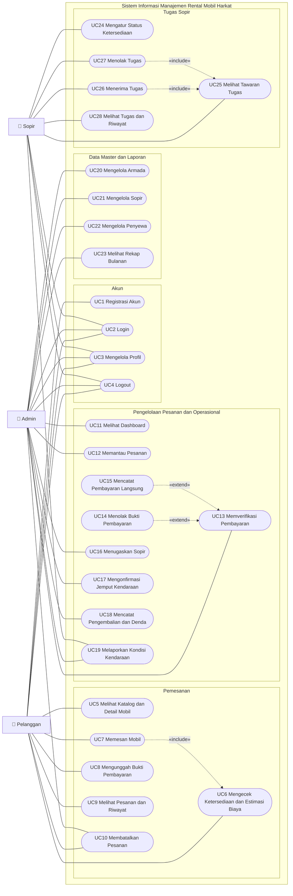
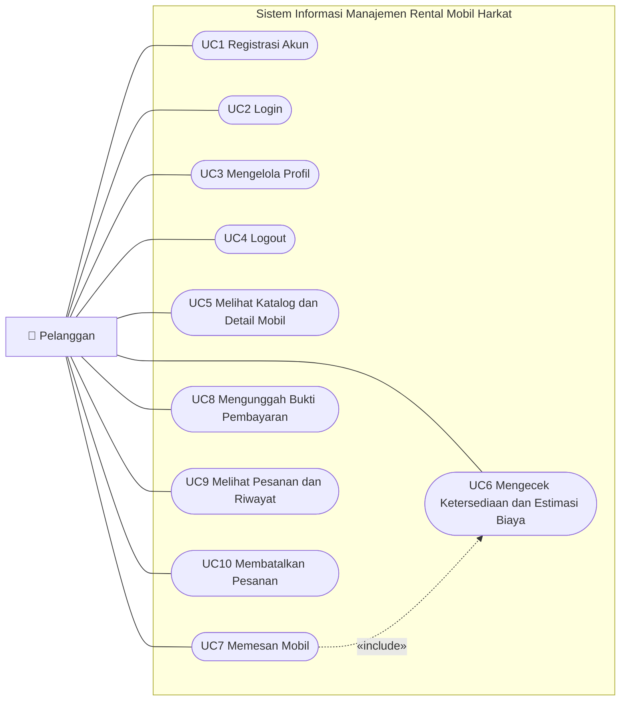
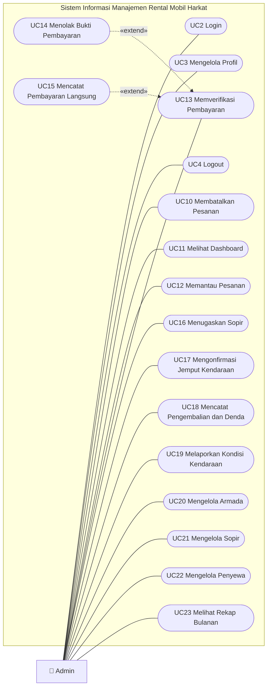
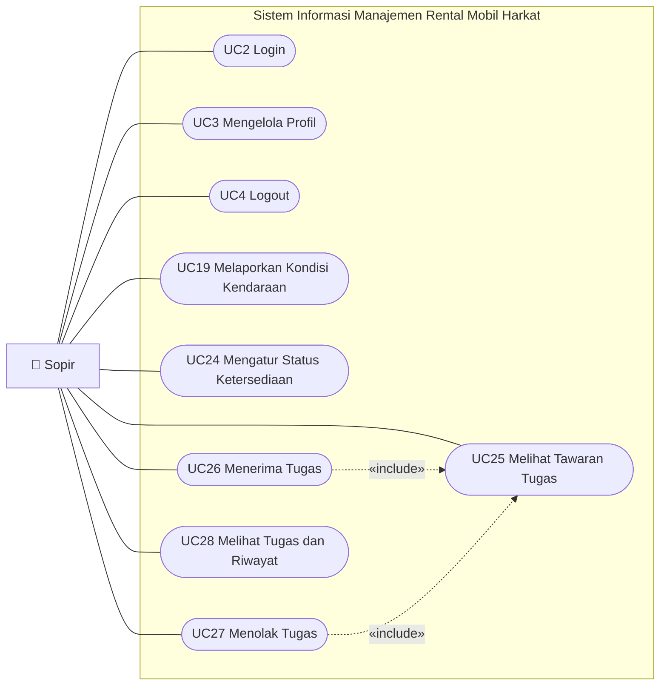

# Use Case Diagram
# Sistem Informasi Manajemen Rental Mobil Harkat Yogyakarta (Aplikasi Mobile Flutter + RESTful API Laravel)

> **Versi:** 1.0 | **Tanggal:** 7 Oktober 2026
> **Penulis:** Betrand Alfayedh
> **Sumber:** [PRD_API.md](PRD_API.md) §4 (kebutuhan fungsional) dan [PRD_Mobile.md](PRD_Mobile.md) §5 (fitur per peran)
> **Dokumen turunan:** [activity-diagram-rental.md](activity-diagram-rental.md) (AD-n) dan [sequence-diagram-rental.md](sequence-diagram-rental.md) (SD-n). Nomor UC, AD, dan SD sama (AD-7 = activity diagram untuk UC7) agar keterlusuran 1:1 terjaga.
> **Penempatan pada laporan:** BAB III, subbab Perancangan Sistem (use case diagram dan spesifikasinya).

---

## 1. Pendahuluan

Dokumen ini memodelkan kebutuhan fungsional sistem dari sudut pandang pengguna. Sistem melayani **tiga aktor** melalui satu aplikasi mobile yang terhubung ke RESTful API. Tampilan aplikasi ditentukan oleh peran pengguna setelah login.

### 1.1 Aktor

| Aktor | Peran | Cara mendapat akun | Gambaran tugas |
|-------|-------|--------------------|----------------|
| **Pelanggan** | Penyewa kendaraan | Mendaftar sendiri melalui aplikasi | Melihat katalog, memesan mobil, mengunggah bukti pembayaran, memantau dan membatalkan pesanan |
| **Admin** | Pengelola operasional Rental Mobil Harkat | Dibuat oleh pengelola sistem | Memverifikasi pembayaran, memantau pesanan, menugaskan sopir, mengonfirmasi pengambilan kendaraan, mencatat pengembalian dan denda, mengelola armada, sopir, dan penyewa, melihat rekap |
| **Sopir** | Pengemudi pada layanan sewa dengan sopir | Dibuat oleh admin (langsung aktif dan disetujui) | Mengatur status ketersediaan, menerima atau menolak tugas, melihat tugas, dan melaporkan kondisi kendaraan |

> UC2 Login, UC3 Mengelola Profil, dan UC4 Logout dipakai oleh ketiga aktor sehingga masing-masing aktor dihubungkan langsung ke use case tersebut.
> UC5 Melihat Katalog dan Detail Mobil (serta UC6) dapat dilakukan **sebelum login**; login baru diwajibkan saat memesan (UC7) dan mengakses pesanan, riwayat, serta profil. Pengguna yang belum login tetap dimodelkan sebagai aktor Pelanggan (tidak ada aktor Tamu terpisah).
> **Peran Super Admin tidak termasuk dalam sistem.** Pengelolaan data armada dan sopir dilakukan langsung oleh admin tanpa alur persetujuan.

### 1.2 Notasi Diagram

Mermaid tidak menyediakan diagram use case bawaan, sehingga notasi UML dipetakan ke diagram alir (*flowchart*):

| Notasi pada diagram | Arti dalam UML |
|---------------------|----------------|
| `👤 Nama` (persegi) | Aktor |
| Elips / bentuk stadion `([UCn ...])` | Use case |
| Bingkai besar berjudul sistem | Batas sistem (*system boundary*) |
| Garis lurus tanpa panah `---` | *Association* (aktor berinteraksi dengan use case) |
| Panah putus-putus berlabel `«include»` | Use case asal **selalu** memanggil use case tujuan |
| Panah putus-putus berlabel `«extend»` | Use case asal **opsional** menambah perilaku use case tujuan |

---

## 2. Daftar Use Case

| ID | Nama Use Case | Aktor | Deskripsi Singkat |
|----|---------------|-------|-------------------|
| **Akun** | | | |
| UC1 | Registrasi Akun | Pelanggan | Pelanggan membuat akun baru dengan nama, email, dan kata sandi. |
| UC2 | Login | Pelanggan, Admin, Sopir | Pengguna masuk dengan email dan kata sandi; aplikasi menampilkan layar sesuai peran. |
| UC3 | Mengelola Profil | Pelanggan, Admin, Sopir | Pengguna melihat dan mengubah data profil serta mengganti kata sandi. |
| UC4 | Logout | Pelanggan, Admin, Sopir | Pengguna keluar dan sesinya diakhiri. |
| **Pelanggan** | | | |
| UC5 | Melihat Katalog dan Detail Mobil | Pelanggan | Pelanggan menelusuri, mencari, dan memfilter daftar mobil serta melihat detailnya. |
| UC6 | Mengecek Ketersediaan dan Estimasi Biaya | Pelanggan | Pelanggan memilih tanggal sewa lalu melihat mobil yang tersedia dan perkiraan biaya serta uang muka. |
| UC7 | Memesan Mobil | Pelanggan | Pelanggan membuat pesanan satu atau beberapa mobil, dengan atau tanpa sopir. |
| UC8 | Mengunggah Bukti Pembayaran | Pelanggan | Pelanggan mengunggah foto bukti pembayaran uang muka, pelunasan, atau denda. |
| UC9 | Melihat Pesanan dan Riwayat | Pelanggan | Pelanggan memantau status pesanan aktif, tagihan, dan riwayat pesanan. |
| UC10 | Membatalkan Pesanan | Pelanggan, Admin | Pesanan berstatus *Booked* dibatalkan; pelanggan hanya selama uang muka belum terverifikasi. |
| **Admin** | | | |
| UC11 | Melihat Dashboard | Admin | Admin melihat hal yang perlu ditindak serta ringkasan pesanan, armada, dan sopir. |
| UC12 | Memantau Pesanan | Admin | Admin mencari, memfilter, dan melihat rincian pesanan. |
| UC13 | Memverifikasi Pembayaran | Admin | Admin memeriksa bukti unggahan pelanggan lalu menyatakan pembayaran lunas. |
| UC14 | Menolak Bukti Pembayaran | Admin | Admin menolak bukti yang tidak sesuai beserta alasannya agar pelanggan mengunggah ulang. |
| UC15 | Mencatat Pembayaran Langsung | Admin | Admin mencatat pembayaran yang diterima langsung (tunai, transfer, atau QRIS) tanpa bukti unggahan. |
| UC16 | Menugaskan Sopir | Admin | Admin menawarkan tugas unit bersopir kepada sopir yang tersedia. |
| UC17 | Mengonfirmasi Jemput Kendaraan | Admin | Admin mengonfirmasi kendaraan diserahkan kepada pelanggan setelah uang muka lunas. |
| UC18 | Mencatat Pengembalian dan Denda | Admin | Admin mencatat kendaraan kembali; denda keterlambatan dihitung otomatis. |
| UC19 | Melaporkan Kondisi Kendaraan | Admin, Sopir | Kondisi kendaraan sebelum dan sesudah sewa dicatat beserta foto. |
| UC20 | Mengelola Armada | Admin | Admin menambah, mengubah, mengatur status, dan menghapus mobil. |
| UC21 | Mengelola Sopir | Admin | Admin menambah dan mengubah akun sopir serta menonaktifkannya. |
| UC22 | Mengelola Penyewa | Admin | Admin menambah dan mengubah data penyewa. |
| UC23 | Melihat Rekap Bulanan | Admin | Admin melihat rekap pesanan, pendapatan, dan pemakaian armada per bulan. |
| **Sopir** | | | |
| UC24 | Mengatur Status Ketersediaan | Sopir | Sopir menandai dirinya tersedia atau libur. |
| UC25 | Melihat Tawaran Tugas | Sopir | Sopir melihat tawaran tugas yang masih terbuka. |
| UC26 | Menerima Tugas | Sopir | Sopir menerima satu tawaran; hanya satu sopir yang dapat memperoleh tugas yang sama. |
| UC27 | Menolak Tugas | Sopir | Sopir menolak tawaran agar admin dapat menawarkan ke sopir lain. |
| UC28 | Melihat Tugas dan Riwayat | Sopir | Sopir melihat tugas aktif dan tugas yang sudah selesai. |

**Jumlah:** 28 use case (4 akun, 6 pelanggan, 13 admin, 5 sopir; UC10 dan UC19 dipakai bersama oleh dua aktor).

> **Prasyarat umum.** Seluruh use case selain UC1 (Registrasi) dan UC2 (Login) mensyaratkan pengguna sudah login. Hak akses dibatasi di server berdasarkan peran, sehingga aktor tidak dapat menjalankan use case milik peran lain.

---

## 3. Diagram

### 3.1 Use Case Diagram Keseluruhan

Gambar jadi bergaya Enterprise Architect tersedia pada folder [usecase-diagram](usecase-diagram/) (`UC-Pelanggan`, `UC-Admin`, `UC-Sopir`). Mermaid menata letak secara otomatis, sehingga bila gambar keseluruhan terlalu padat untuk halaman laporan, gunakan diagram per aktor pada 3.2 sampai 3.4 sebagai gambar utama.

### 3.2 Use Case Diagram — Aktor Pelanggan

### 3.3 Use Case Diagram — Aktor Admin

### 3.4 Use Case Diagram — Aktor Sopir

---

## 4. Relasi Antar Use Case

| Use case asal | Relasi | Use case tujuan | Penjelasan |
|---------------|--------|-----------------|------------|
| UC7 Memesan Mobil | «include» | UC6 Mengecek Ketersediaan dan Estimasi Biaya | Setiap pemesanan selalu didahului pengecekan jadwal dan penghitungan biaya. Pelanggan juga dapat menjalankan UC6 sendiri tanpa memesan. |
| UC14 Menolak Bukti Pembayaran | «extend» | UC13 Memverifikasi Pembayaran | Saat memeriksa bukti, admin **dapat** menolaknya bila tidak sesuai. |
| UC15 Mencatat Pembayaran Langsung | «extend» | UC13 Memverifikasi Pembayaran | Bila pembayaran diterima langsung, admin **dapat** mencatatnya lunas tanpa bukti unggahan. |
| UC26 Menerima Tugas | «include» | UC25 Melihat Tawaran Tugas | Sopir harus melihat tawaran sebelum menerimanya. |
| UC27 Menolak Tugas | «include» | UC25 Melihat Tawaran Tugas | Sopir harus melihat tawaran sebelum menolaknya. |

**Use case yang dipakai bersama dua aktor:** UC10 (pelanggan dan admin) dan UC19 (admin dan sopir). Aturan yang berbeda per aktor dijelaskan pada spesifikasi dan activity diagram masing-masing.

---

## 5. Spesifikasi Use Case Utama

Lima use case berikut adalah fitur utama yang menghubungkan tiga aktor dan dijadikan fokus pada BAB III. Spesifikasi use case lain mengikuti activity diagram pada [activity-diagram-rental.md](activity-diagram-rental.md).

### UC7 — Memesan Mobil

| Elemen | Keterangan |
|--------|------------|
| **Aktor** | Pelanggan |
| **Tujuan** | Membuat pesanan sewa satu atau beberapa mobil untuk periode tertentu. |
| **Prasyarat** | Pelanggan sudah login dan profil (alamat, nomor HP, asal kota) sudah lengkap. |
| **Kondisi akhir (sukses)** | Pesanan tersimpan berstatus *Booked*; tagihan uang muka (50% total) terbentuk lengkap dengan batas pembayaran. |
| **Alur utama** | 1. Pelanggan memilih mobil dan mengisi tanggal sewa, tanggal kembali, serta pilihan dengan atau tanpa sopir. 2. Sistem mengecek jadwal dan menampilkan estimasi biaya serta uang muka (UC6). 3. Pelanggan mengisi asal kota dan jaminan, lalu menekan Pesan. 4. Sistem memeriksa ulang ketersediaan, menyimpan pesanan, dan membentuk tagihan uang muka. 5. Sistem menampilkan pesanan beserta batas pembayaran. |
| **Alur alternatif** | A1. Profil belum lengkap → sistem meminta pelanggan melengkapinya dahulu. A2. Waktu sewa kurang dari 3 jam dari sekarang, atau tanggal kembali tidak setelah tanggal sewa → pesanan ditolak dengan pesan kesalahan. A3. Mobil tidak tersedia atau jadwalnya bentrok → pesanan ditolak; bila salah satu mobil dalam pesanan banyak mobil bentrok, seluruh pesanan dibatalkan. |
| **Aturan bisnis** | Biaya = tarif × jumlah hari (dibulatkan ke atas per 24 jam); uang muka 50%. |

### UC13 — Memverifikasi Pembayaran

| Elemen | Keterangan |
|--------|------------|
| **Aktor** | Admin |
| **Tujuan** | Menyatakan pembayaran pelanggan sah dan lunas. |
| **Prasyarat** | Admin sudah login; pelanggan sudah mengunggah bukti (status pembayaran *Menunggu verifikasi*). |
| **Kondisi akhir (sukses)** | Pembayaran berstatus *Lunas* dan pencatatnya tersimpan. Bila yang diverifikasi uang muka, tagihan pelunasan terbentuk; invoice dikirim ke surel pelanggan. |
| **Alur utama** | 1. Admin membuka pembayaran yang menunggu verifikasi. 2. Sistem menampilkan rincian dan foto bukti. 3. Admin memeriksa bukti lalu memilih Verifikasi dan mengonfirmasi. 4. Sistem mengubah status menjadi lunas, membentuk tagihan pelunasan (untuk uang muka), dan mengirim invoice. |
| **Alur alternatif** | A1 (UC14). Bukti tidak sesuai → admin menolak dengan alasan; status kembali *Belum dibayar* dan pelanggan dapat mengunggah ulang. A2 (UC15). Pembayaran diterima langsung → admin mencatatnya lunas tanpa bukti. A3. Pembayaran tidak lagi menunggu verifikasi atau pesanan sudah dibatalkan → sistem menolak dengan pesan. A4. Invoice gagal terkirim → pembayaran tetap lunas dan admin diberi tahu. |

### UC16 — Menugaskan Sopir

| Elemen | Keterangan |
|--------|------------|
| **Aktor** | Admin |
| **Tujuan** | Menawarkan tugas kepada sopir untuk unit yang disewa dengan sopir. |
| **Prasyarat** | Unit disewa dengan sopir, belum memiliki sopir, dan pesanan masih *Booked*. |
| **Kondisi akhir (sukses)** | Tawaran terkirim ke seluruh sopir yang tersedia, disetujui, dan aktif; unit berstatus menunggu jawaban sopir. |
| **Alur utama** | 1. Admin membuka rincian pesanan dan memilih Tugaskan sopir. 2. Sistem mencari sopir yang tersedia, disetujui, dan aktif (tidak termasuk yang sudah menolak unit ini). 3. Sistem membuat tawaran bagi tiap sopir tersebut dan memberi tahu admin jumlahnya. |
| **Alur alternatif** | A1. Unit disewa tanpa sopir atau sudah memiliki sopir → ditolak. A2. Tidak ada sopir yang tersedia → ditolak dengan pesan "Tidak ada supir yang available". |

### UC26 — Menerima Tugas

| Elemen | Keterangan |
|--------|------------|
| **Aktor** | Sopir |
| **Tujuan** | Mengambil tugas yang ditawarkan admin. |
| **Prasyarat** | Sopir sudah login, berstatus tersedia, dan memiliki tawaran terbuka (UC25). |
| **Kondisi akhir (sukses)** | Sopir tercatat pada unit; status sopir menjadi *Bertugas*; tawaran sopir lain untuk unit yang sama ditutup. |
| **Alur utama** | 1. Sopir memilih tawaran dan menekan Terima. 2. Sistem meminta konfirmasi. 3. Sopir mengonfirmasi. 4. Sistem mengunci tugas, memasangkan sopir pada unit, menutup tawaran lain, dan mengubah status sopir. |
| **Alur alternatif** | A1. Tugas sudah diambil sopir lain atau pesanan tidak lagi aktif → ditolak dengan pesan dan daftar tawaran disegarkan. A2. Sopir tidak berstatus tersedia atau belum disetujui → ditolak. |
| **Aturan bisnis** | Bila dua sopir menerima bersamaan, hanya satu yang berhasil. |

### UC18 — Mencatat Pengembalian dan Denda

| Elemen | Keterangan |
|--------|------------|
| **Aktor** | Admin |
| **Tujuan** | Mencatat kendaraan sudah kembali dan menghitung denda keterlambatan. |
| **Prasyarat** | Unit sudah dijemput (status *Ongoing*) dan belum pernah dicatat pengembaliannya. |
| **Kondisi akhir (sukses)** | Pengembalian tercatat; unit selesai; pesanan *Done* bila seluruh unit sudah kembali; mobil berstatus *Maintenance* (kondisi baik) atau *Rusak*; sopir kembali tersedia; denda tertagih. |
| **Alur utama** | 1. Admin membuka unit dan memilih Catat pengembalian. 2. Admin mengisi waktu kembali sebenarnya, kondisi, catatan, dan foto. 3. Aplikasi menampilkan pratinjau denda; admin mengonfirmasi. 4. Sistem menghitung keterlambatan (Rp50.000 per jam yang sudah dimulai), menambahkannya ke tagihan pelunasan (atau membuat tagihan denda terpisah bila pelunasan sudah lunas), lalu memperbarui status unit, pesanan, mobil, dan sopir. |
| **Alur alternatif** | A1. Waktu kembali sebelum tanggal sewa → ditolak. A2. Unit belum dijemput atau sudah dikembalikan → ditolak. |

---

## 6. Keterlusuran

| Kelompok UC | Bagian PRD_API | Bagian PRD_Mobile |
|-------------|----------------|-------------------|
| UC1–UC4 | §4.1 Autentikasi dan Profil | §5.1 Umum |
| UC5–UC10 | §4.2 Pelanggan | §5.2 Pelanggan |
| UC11–UC23 | §4.3 Admin | §5.3 Admin |
| UC24–UC28 | §4.4 Sopir | §5.4 Sopir |

Seluruh use case telah diuji pada pengujian black box (lihat [PENGUJIAN.md](PENGUJIAN.md)).
